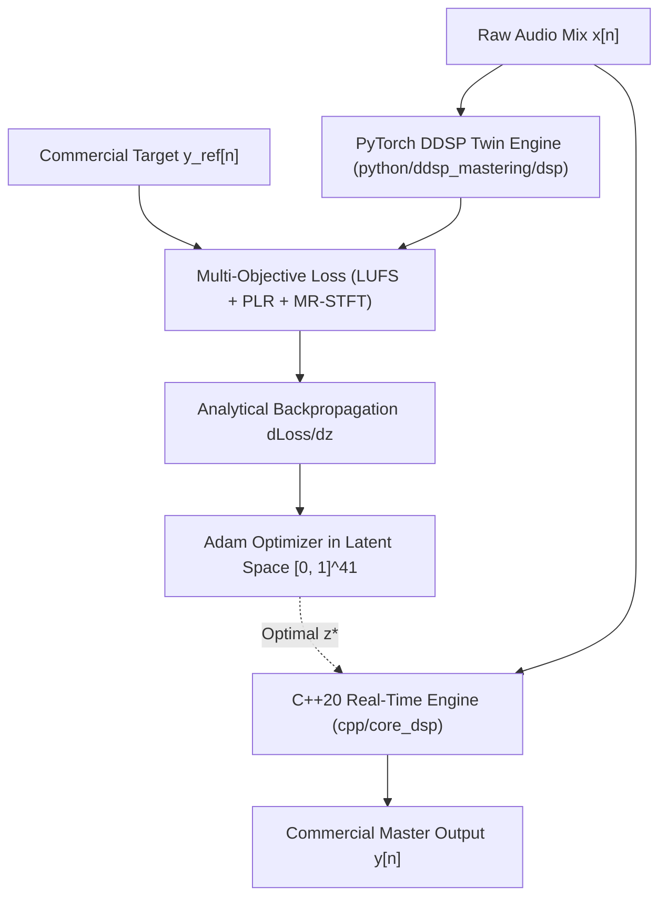

# AutoMastering PoliMi 🎛️

> **Differentiable Digital Signal Processing (DDSP) White-Box Audio Mastering Suite**  
> *Master's Thesis & Research Prototype — Politecnico di Milano (Sound & Music Engineering)*  
> Architecture: Real-Time C++20 / JUCE 8 Engine + PyTorch Differentiable Twin Engine

---

## 📌 Executive Summary

**AutoMastering PoliMi** is a hybrid **white-box automatic audio mastering system**. Unlike opaque black-box deep learning models (such as direct waveform generation via WaveNet or diffusion models) that suffer from phase artifacts, high latency, and zero explainability, AutoMastering PoliMi couples:

1. **A Real-Time C++20 Audio Mastering DSP Engine** (SIMD-accelerated, zero-allocation audio thread, JUCE 8 VST3 / Standalone).
2. **A Pure Differentiable PyTorch Twin Engine** that models every DSP stage (IIR Biquad EQ, Linkwitz-Riley crossover, envelope follower, multiband compressor, Blumlein M/S imager, oversampled saturator, and lookahead true-peak limiter) end-to-end with analytical autograd gradients.
3. **Psychoacoustic Multi-Objective Loss Suite**:
   - Multi-Resolution STFT (MR-STFT) Spectral Convergence & Log-Magnitude Distance.
   - ITU-R BS.1770-4 K-weighted Integrated Loudness ($\mathcal{L}_{\text{LUFS}}$).
   - Peak-to-Loudness Ratio ($\mathcal{L}_{\text{PLR}}$) Dynamic Range Matching.

---

## 🏛️ System Architecture



### The 41-Dimensional Continuous Parameter Vector $z \in [0, 1]^{41}$

Every physical parameter is mapped through smooth monotonic transfer functions (linear or log-frequency/ratio):

1. **6-Band Parametric EQ (18 params)**: 6 bands $\times$ ($f_0 \in [20\text{ Hz}, 20\text{ kHz}]$, Gain $\in [-12, +12]\text{ dB}$, $Q \in [0.5, 5.0]$).
2. **LR4 Crossover (2 params)**: Low cutoff $f_{\text{low}} \in [80, 350]\text{ Hz}$, High cutoff $f_{\text{high}} \in [1500, 6000]\text{ Hz}$.
3. **3-Band Dynamics Compressor (15 params)**: Low, Mid, High bands $\times$ (Threshold $[-40, 0]\text{ dB}$, Ratio $[1:1, 20:1]$, Attack $[0.5, 100]\text{ ms}$, Release $[10, 1000]\text{ ms}$, Makeup Gain $[-6, +12]\text{ dB}$).
4. **Mid/Side Blumlein Imager (3 params)**: Low band width $[0.0, 1.2]$ (mono bass centering), Mid band width $[0.5, 2.0]$, High band width $[0.5, 2.0]$.
5. **Polyphase 2x Oversampled Saturator (2 params)**: Drive $[0, 18]\text{ dB}$, Wet/Dry Mix $[0.0, 1.0]$.
6. **Lookahead Sample-Peak Brickwall Limiter (1 param)**: Push gain $[0, 12]\text{ dB}$, $-0.30\text{ dBFS}$ ceiling.

### 🎚️ Sample Rate Contract & Core Latency Specification
- **Reference Sampling Rate**: **48 kHz** is the primary reference and the only sample rate validated end-to-end at baseline.
- **Deterministic Latency**: The chain latency is fixed at **159 samples** (15 samples FIR Half-Band $+ 144$ samples Limiter Lookahead). At 48 kHz, this equals **3.31 ms** ($159 / 48000$). At different sample rates, latency remains 159 samples ($159 / f_s$), and operation is characterized but not formally validated.
- **Limiter Topology**: The core limiter operates as a **Sample-Peak Lookahead Brickwall Limiter** with smooth boxcar attack and single-pole release. True Peak oversampling ($4\times$) is measured in the objective benchmark suite per ITU-R BS.1770-5 Annex 2.

---

## 🔬 Critical Audio Engineering Review & Open Research Questions

While the optimization mathematically converges to tight metrics (matching LUFS to within $\pm 0.3\text{ LU}$ and improving Log-Spectral Distance by $10\text{--}15\text{ dB}$ with $0.00\text{ dB}$ True-Peak ceiling violation), **critical listening tests on real-world commercial tracks (Pop, Hip-Hop, Disco) reveal audible limitations**:

1. **Spectral Loss vs Psychoacoustic Perception**:
   - The current MR-STFT loss calculates uniform L1/L2 distance across all FFT bins. Human hearing is logarithmic (Bark / ERB scale) and governed by equal loudness contours (ISO 226) and frequency masking. A small error in the harsh $2\text{--}5\text{ kHz}$ region sounds fatiguing, whereas low-frequency phase shifts are perceived differently.
2. **Transient vs Sustain Smearing**:
   - Standard L1 spectral distance penalizes phase cancellation and pushes high gains, which can soften sharp snare/kick transients.
3. **Short-Window Optimization**:
   - Optimizing on a $0.5\text{--}1.0\text{ s}$ audio chunk finds parameters that fit that micro-segment, but misses verse-chorus macro-dynamics, full-track RMS crest factor, and tempo-synchronized release times.
4. **Parameter Coupling & Conditioning**:
   - EQ pre-gain directly changes the energy entering the compressor thresholds. This non-orthogonal interaction can lead the optimizer into local minima.
5. **Feed-Forward Neural Parameter Estimator (Phase 3)**:
   - Designing an efficient convolutional/recurrent encoder $x[n] \mapsto z \in [0, 1]^{41}$ that masters tracks in a single inference pass without running gradient descent at runtime.

---

## 🛠️ Project Structure

```
AutoMastering/
├── CMakeLists.txt                 # JUCE 8 & C++20 CMake build configuration
├── setup.py                       # pybind11 C++ extension build
├── pytest.ini                     # Pytest suite configuration
├── cpp/
│   ├── core_dsp/                  # Clean, header-only C++20 real-time DSP
│   │   ├── Biquad.h               # SIMD-friendly biquad filters (Direct Form II Transposed)
│   │   ├── LinkwitzRiley4.h       # 4th-order Linkwitz-Riley phase-coherent crossover
│   │   ├── MultibandCompressor.h  # 3-band peak/RMS compressor
│   │   ├── StereoImager.h         # Blumlein M/S stereo widener
│   │   ├── Saturator.h            # 2x oversampled polynomial/tanh tape saturator
│   │   ├── Limiter.h              # Lookahead True-Peak brickwall limiter
│   │   └── MasteringChain.h       # Full 41-param mastering pipeline
│   ├── bindings/                  # pybind11 C++ <-> Python bridge (py_core_dsp)
│   └── plugin/                    # JUCE 8 VST3 and Standalone GUI application
├── python/
│   └── ddsp_mastering/
│       ├── dsp/                   # PyTorch differentiable mirrors of all DSP blocks
│       ├── loss/                  # MR-STFT, ITU-R BS.1770-4 LUFS, PLR loss
│       ├── optimize/              # AutoMasteringOptimizer & MasteringBenchmarkSuite
│       └── data/                  # Synthetic audio & Stem dataset generators
├── docs/                          # Architectural plans, audit reviews, and Argon logs
└── scratch/output_mastering/      # Exported presets & benchmark outputs
```

---

## 🚀 Building & Testing

### 1. Python Environment Setup
```bash
# Clone the repository
git clone https://github.com/gio961gio/AutoMastering.git
cd AutoMastering

# Install Python package and build C++ pybind11 extension
pip install -e .
```

### 2. Run Regression & DSP Parity Unit Tests
```bash
pytest python/tests/ -v
```
All tests verify strict bitwise / numerical parity between PyTorch differentiable twin and C++20 engine ($\text{MAE} < 10^{-4}$).

### 3. Build JUCE 8 VST3 & Standalone App
```bash
cmake -B build_juce -G Ninja -DCMAKE_BUILD_TYPE=Release
cmake --build build_juce --config Release
```
Artifacts are generated in `build_juce/MasteringPlugin_artefacts/Release/`:
- `Standalone/AutoMastering PoliMi.exe`
- `VST3/AutoMastering PoliMi.vst3`

---

## 👨‍💻 Author & Academic Context

* **Student / Author**: Giovanni Antonecchia ([@gio961gio](https://github.com/gio961gio))
* **Institution**: Politecnico di Milano — School of Industrial and Information Engineering
* **Program**: MSc in Music and Acoustic Engineering (Sound and Music Engineering track)
* **Advisors / Supervisors**: Department of Electronics, Information and Bioengineering (DEIB)
