# SPRINT 3 — SPECIFICA MATEMATICA E ARCHITETTURALE PRE-IMPLEMENTAZIONE V3b (DYNAMIC PRIORS)
## Studio di Coerenza V3a (`z` vs `theta`), Formulazione Rigorosa dei Termini di Dinamica ed Estensione della Catena DSP Differentiable

**Data:** 11 Novembre 2026  
**Autore:** Antigravity (Advanced Agentic Coding / DDSP Audio Team)  
**Supervisore Tecnico:** Argon (Gemini Web Pro / Medium Thinking)  
**Repository:** `gio961gio/AutoMastering`  
**Branch:** `human-validation-package`  
**Commit di riferimento:** `5267a6db6eae54b6ba0ed791140c68a5ea97e9ba`  
**Stato:** SPECIFICA TECNICA REVISIONATA (MODALITÀ READ-ONLY — ZERO MODIFICHE AL CODICE)

---

## 1. EXECUTIVE SUMMARY

### 1.1 Obiettivi e Posizionamento dello Step V3b
Lo Step **`V3b`** della roadmap di Sprint 3 si prefigge di analizzare e regolarizzare il comportamento dinamico della catena di mastering differenziabile, affrontando la configurazione degenere riscontrata nelle varianti `V0p`, `V1`, `V1b`, `V2` e `V3a`. Come evidenziato nell'ispezione dei parametri:
1. I ratio del compressore multibanda si attestano costantemente su valori nominali vicini a $1.00:1$;
2. I makeup gain $M_c$ si collocano stabilmente nella regione positiva ($+1.37 \dots +1.42\text{ dB}$ in *same_track* e fino a $+1.41\text{ dB}$ in *stylistic*, a fronte di un intervallo ammesso $[-3.0, +6.0]\text{ dB}$);
3. La limitazione di picco e il contenimento finale della loudness vengono assorbiti dal limiter lookahead finale, producendo elevati sforamenti del True Peak delivery nel rendering full-track (fino a $+1.77\text{ dBTP}$).

L'obiettivo di `V3b` è implementare in **puro isolamento** la combinazione:
$$V_{3b} = V_{0p} + \mathcal{L}_{\text{dyn\_priors}}$$
dove $\mathcal{L}_{\text{dyn\_priors}} = w_{\text{lim}} \mathcal{L}_{\text{lim}} + w_{\text{diff}} \mathcal{L}_{\text{diff}} + w_{\text{conflict}} \mathcal{L}_{\text{conflict}}$.
In ossequio ai vincoli tassativi di isolamento dello Sprint 3:
- In `V3b` **NON** è attivo il prior composito dell'EQ di `V3a` ($w_{\text{eq\_prior}} = 0.0$);
- **NON** sono attivi i termini di `V1` o `V2` ($\text{ERB} = 0$, $\text{De-Harsh} = 0$, Transient $= 0$);
- Il True Peak Limiter non entra nella loss differenziabile e resta confinato alla fase di delivery post-mastering.

### 1.2 Sintesi dell'Audit di Coerenza V3a (`normalized_z_opt` vs `physical_parameters_theta`)
L'ispezione analitica in sola lettura ha chiarito l'esatta catena di trasformazione dei parametri e la natura dei dati salvati nei file JSON:
1. **Catena Reale Verificata nel Codice:** Non esiste nel codice alcuna funzione `map_u_to_z()` né una trasformazione `tanh` a 21 parametri. Il codice adotta linearmente:
   $$u \in \mathbb{R}^{41} \;\xrightarrow{\text{sigmoid}}\; z \in (0, 1)^{41} \;\xrightarrow{\text{map\_z\_to\_theta}}\; \theta \in \mathbb{R}^{41}$$
   Il tensore salvato in `SPRINT3_V3A_ABLATION_RESULTS.json` come `"normalized_z_opt"` è strettamente vincolato nell'ipercubo unitario aperto $(0, 1)^{41}$ (su tutte le sessioni, $\min(z) \ge 0.0000$ e $\max(z) \le 0.9192$).
2. **Coerenza Rigorosa sulle Dimensioni 0..39:** Per tutte le prime 40 dimensioni (EQ biquad 0..5, frequenze di crossover, compressore multibanda, stereo imager e saturatore), $\text{map\_z\_to\_theta}(z_{\text{JSON}})$ coincide con `physical_parameters_theta` salvato nel JSON entro la precisione di macchina ($< 10^{-5}$).
3. **Isolamento della Discrepanza sul Limiter (Dimensione 40):** In `SPRINT3_V2_ABLATION_RESULTS.json`, la dimensione 40 rispetta esattamente $\theta_{40} = 8.0 \cdot z_{40}$ ($\approx 0.0015\text{ dB}$). In `SPRINT3_V3A_ABLATION_RESULTS.json`, per entrambe le varianti (`V0p` e `V3a`), la chiave `physical_parameters_theta["limiter_push_gain_db"]` contiene invece valori coincidenti con `lim_input_gain_db` (livello RMS empirico di ingresso, es. $+8.63\text{ dB}$).
   - **Nota di Rigore Metodologico:** Nel codice committato di `scripts/sprint3/evaluate_v3a_ablation.py` al commit `5267a6d`, la mappatura è `theta_v3a = map_z_to_theta(z_opt_v3a)`. La sovrascrittura di `"limiter_push_gain_db"` con `lim_input_gain_db` nei JSON committati non risulta da alcuna riga presente in `evaluate_v3a_ablation.py` ed è pertanto dichiarata formalmente come **non tracciata nella cronologia Git del runner**.
4. **Validità Matematica di `CompositeEQPriorLoss`:** Il modulo `eq_prior.py` riceve direttamente $z \in (0, 1)^{41}$ e chiama `map_z_to_theta(z)`. Tutti i calcoli di risposta in frequenza dell'EQ, offset $\bar{G}$, deviazioni di forma e loss di prior in `SPRINT3_V3A_ABLATION_RESULTS.json` sono **validi ed esatti al 100%**.

### 1.3 Sintesi delle Scelte Architetturali Approvate per V3b
1. **Latenza di catena compensata esattamente a 159 campioni:** Il budget di latenza della catena DSP differenziabile è di $15$ campioni per il saturatore e $144$ campioni per il lookahead limiter ($0$ per EQ, crossover, compressore e imager). Il tracciamento temporale delle serie temporali di gain reduction del compressore ($GR_c[n]$) e del limiter ($A_{\text{lim}}[n]$) richiede una traslazione esatta di $159$ campioni per garantire che entrambi i rilevatori valutino la medesima porzione fisica del segnale audio.
2. **Eliminazione dell'incoerenza dimensionale in $\mathcal{L}_{\text{conflict}}$ tramite Rational Soft-Gate (Approvato Q3):** La formulazione grezza del prodotto $[\text{dB}] \times [\text{dB}^2] = [\text{dB}^3]$ viene sostituita dal Rational Soft-Gate adimensionale:
   $$r = \text{ReLU}\left(\bar{A}_{\text{lim}}^{\text{act}} - \tau_{\text{avg}}\right), \qquad h_{\text{lim}} = \text{detach}\left(\frac{r}{r + \Delta_{\text{ref}}}\right) \in [0, 1)$$
   $$\mathcal{L}_{\text{conflict}} = h_{\text{lim}} \cdot \frac{1}{3}\sum_{c \in \{L,M,H\}} \text{ReLU}\left(M_c - \text{detach}(\bar{GR}_c^{\text{act}}) - \delta_M\right)^2 \quad [\text{dB}^2]$$
3. **Neutralizzazione del "Perverse Incentive" su $\bar{GR}_c$ (Approvato Q4):** L'inserimento di $\text{stop\_gradient}(\bar{GR}_c^{\text{act}})$ e di $\text{detach}(h_{\text{lim}})$ confina i gradienti di $\mathcal{L}_{\text{conflict}}$ **esclusivamente sui 3 makeup gain $M_c$**, azzerando il rischio che l'ottimizzatore aumenti la compressione per eludere la penalità.
4. **Surrogato differenziabile CVaR per $P_{95}$ (Approvato Q2):** Per la retropropagazione si adotta la Tail Mean del 5% superiore ($\text{CVaR}_{0.95}^{\text{act}}$ tramite `torch.topk`), preservando $P_{95}^{\text{act}}$ esatto come metrica diagnostica e di reporting.
5. **Aggregazione Multi-Chunk per Media Pesata Per-Chunk (Approvato Q5):** Media pesata con pesi fissi $w_k = 1/4$, ciascun termine normalizzato sui campioni attivi del rispettivo chunk.

---

## 2. AUDIT DI COERENZA V3a E AUDIT DEI COMPONENTI DSP ESISTENTI

### 2.1 Audit di Coerenza V3a (`normalized_z_opt` vs `physical_parameters_theta`)

#### A. Catena di Mappatura Reale Verificata nel Codice
Nel codice sorgente al commit `5267a6d`:
- In `python/ddsp_mastering/param_space.py`:
  - Sono definite unicamente `map_z_to_theta(z)` e `map_theta_to_z(theta)`.
  - Non esiste alcuna funzione denominata `map_u_to_z()` e non esiste alcuna trasformazione basata su `tanh` o suddivisione a 21/20 parametri.
  - Per i parametri lineari (`scale="linear"`), $\theta_i = \text{min\_val}_i + z_i (\text{max\_val}_i - \text{min\_val}_i)$.
  - Per i parametri logaritmici (`scale="log"`), $\theta_i = \text{min\_val}_i \cdot (\text{max\_val}_i / \text{min\_val}_i)^{z_i}$.
- In `python/ddsp_mastering/optimize/optimizer.py` (righe 244 e 327):
  - L'ottimizzatore Adam aggiorna il tensore $u \in \mathbb{R}^{41}$.
  - A ogni step viene calcolato $z = \text{torch.sigmoid}(u) \in (0, 1)^{41}$.
  - Alla riga 327 viene estratto `optimal_z = torch.sigmoid(u).detach()`.
- In `python/ddsp_mastering/loss/eq_prior.py` (riga 69):
  - La funzione di loss riceve `normalized_params` (il tensore $z$) e calcola `theta = map_z_to_theta(normalized_params)`.
- Pertanto, la catena reale verificata nel codice è rigorosamente:
  $$u \in \mathbb{R}^{41} \;\xrightarrow{\text{sigmoid}}\; z \in (0, 1)^{41} \;\xrightarrow{\text{map\_z\_to\_theta}}\; \theta \in \mathbb{R}^{41}$$
  Non deve essere introdotta alcuna trasformazione `tanh` e nessuna operazione supplementare su `normalized_z_opt`.

#### B. Ispezione Empirica sulle 41 Dimensioni nelle 6 Sessioni Armonizzate
È stato eseguito il ricalcolo analitico completo $\hat{\theta} = \text{map\_z\_to\_theta}(z_{\text{JSON}})$ per tutte le 6 sessioni armonizzate, confrontandolo sia con `SPRINT3_V2_ABLATION_RESULTS.json` sia con `SPRINT3_V3A_ABLATION_RESULTS.json`.
- **Dimensioni $0 \dots 17$ (Parametri Biquad EQ 0..5):** Allineamento identico entro $10^{-5}$ su guadagni e Q, ed entro $< 0.0005\text{ Hz}$ sulle frequenze a $10\text{ kHz}$.
- **Dimensioni $18 \dots 19$ (Frequenze di Crossover LR4):** $f_{\text{low}}$ ($120\text{ Hz}$) e $f_{\text{high}}$ ($4000\text{ Hz}$) allineate entro $10^{-6}\text{ Hz}$.
- **Dimensioni $20 \dots 34$ (Parametri Compressore Multibanda):**
  - Soglie, ratio, attack e release allineati entro $10^{-6}$.
  - I makeup gain $M_c$ (`comp_low_makeup_db`, `comp_mid_makeup_db`, `comp_high_makeup_db`) hanno range fisico $[-3.0, +6.0]\text{ dB}$. I valori calcolati $\hat{\theta}$ e salvati nei JSON coincidono esattamente su $+1.37 \dots +1.42\text{ dB}$ (sessioni *same_track*) e $-1.11 \dots +1.41\text{ dB}$ (sessioni *stylistic*).
- **Dimensioni $35 \dots 37$ (Stereo Imager) e $38 \dots 39$ (Saturatore):** Allineamento perfetto ($|\Delta| < 10^{-6}$).
- **Dimensione 40 (`limiter_push_gain_db`):** Range fisico $[0.0, 8.0]\text{ dB}$, scala lineare.
  La formula analitica impone:
  $$P_{\text{lim}} = 0.0 + z_{40} \cdot (8.0 - 0.0) = 8.0 \cdot z_{40}$$

#### C. Tabella Comparativa della Dimensione 40 tra V2 e V3a

| Sessione Armonizzata | Variante | $z_{40}$ (JSON) | $\hat{\theta}_{40} = 8.0 \cdot z_{40}$ | $\theta_{\text{JSON}}^{\text{V2}}$ | $\theta_{\text{JSON}}^{\text{V3a}}[\text{lim\_push}]$ | $\theta_{\text{JSON}}^{\text{V3a}}[\text{lim\_input}]$ | Stato di Coerenza |
| :--- | :---: | :---: | :---: | :---: | :---: | :---: | :---: |
| **`track01_same`** | `V0p` | $0.00019419$ | $0.001553\text{ dB}$ | $0.001553\text{ dB}$ | $+8.63\text{ dB}$ | $+8.63\text{ dBFS}$ | V2: Conforme / V3a: Non allineato |
| | `V3a` | $0.00019437$ | $0.001555\text{ dB}$ | — | $+8.63\text{ dB}$ | $+8.63\text{ dBFS}$ | V3a: Non allineato |
| **`track02_same`** | `V0p` | $0.00019486$ | $0.001559\text{ dB}$ | $0.001559\text{ dB}$ | $+8.63\text{ dB}$ | $+8.63\text{ dBFS}$ | V2: Conforme / V3a: Non allineato |
| | `V3a` | $0.00019501$ | $0.001560\text{ dB}$ | — | $+8.63\text{ dB}$ | $+8.63\text{ dBFS}$ | V3a: Non allineato |
| **`track03_same`** | `V0p` | $0.00019431$ | $0.001554\text{ dB}$ | $0.001554\text{ dB}$ | $+8.76\text{ dB}$ | $+8.76\text{ dBFS}$ | V2: Conforme / V3a: Non allineato |
| | `V3a` | $0.00019446$ | $0.001556\text{ dB}$ | — | $+8.76\text{ dB}$ | $+8.76\text{ dBFS}$ | V3a: Non allineato |
| **`track01_style`** | `V0p` | $0.00005387$ | $0.000431\text{ dB}$ | $0.000431\text{ dB}$ | $-4.88\text{ dB}$ | $-4.88\text{ dBFS}$ | V2: Conforme / V3a: Non allineato |
| | `V3a` | $0.00005384$ | $0.000431\text{ dB}$ | — | $-4.88\text{ dB}$ | $-4.88\text{ dBFS}$ | V3a: Non allineato |
| **`track02_style`** | `V0p` | $0.00019444$ | $0.001555\text{ dB}$ | $0.001555\text{ dB}$ | $+6.06\text{ dB}$ | $+6.06\text{ dBFS}$ | V2: Conforme / V3a: Non allineato |
| | `V3a` | $0.00019445$ | $0.001556\text{ dB}$ | — | $+6.06\text{ dB}$ | $+6.06\text{ dBFS}$ | V3a: Non allineato |
| **`track03_style`** | `V0p` | $0.00019411$ | $0.001553\text{ dB}$ | $0.001553\text{ dB}$ | $+8.33\text{ dB}$ | $+8.33\text{ dBFS}$ | V2: Conforme / V3a: Non allineato |
| | `V3a` | $0.00019412$ | $0.001553\text{ dB}$ | — | $+8.33\text{ dB}$ | $+8.33\text{ dBFS}$ | V3a: Non allineato |

#### D. Tracciabilità Git e Dichiarazione di Rigore Metodologico
Dall'ispezione della cronologia Git (`git log -p -S "lim_input_gain_db"` e `git log --oneline scripts/sprint3/evaluate_v3a_ablation.py`):
1. In `scripts/sprint3/evaluate_v3a_ablation.py` (righe 638–643), il codice assegna regolarmente `theta_v3a_dict = {spec.name: float(theta_v3a[name_to_idx[spec.name]].item()) for spec in PARAM_SPECS}`.
2. La presenza dei valori empirici ($+8.63\text{ dB}$, $+8.76\text{ dB}$, etc.) sotto la chiave `"limiter_push_gain_db"` in `SPRINT3_V3A_ABLATION_RESULTS.json` non è prodotta dal codice committato di `evaluate_v3a_ablation.py`, bensì deriva da un passaggio di serializzazione/post-elaborazione non tracciato nella cronologia Git del runner.
3. Di conseguenza, si dichiara formalmente che tale discrepanza è un **disallineamento metadato/documentale non tracciato**, che non ha in alcun modo influenzato il forward/backward di PyTorch né l'ottimizzazione Adam.

#### E. Separazione Formale dei Campi per gli Artefatti Futuri
Nei futuri runner di Sprint 3, la struttura degli artefatti JSON adotterà una separazione rigida in 4 dizionari distinti:
1. `unconstrained_u_opt`: Vettore $u \in \mathbb{R}^{41}$ ottimizzato da Adam nello spazio non vincolato;
2. `normalized_z_opt`: Vettore proiettato $z = \text{sigmoid}(u) \in (0, 1)^{41}$ passato alla catena DSP;
3. `physical_parameters_theta`: Parametri fisici $\theta = \text{map\_z\_to\_theta}(z)$, dove la chiave `"limiter_push_gain_db"` deve contenere esclusivamente $\theta_{40} = 8.0 \cdot z_{40}$;
4. `empirical_audio_metrics`: Misure empiriche sul segnale (incluso `limiter_input_rms_dbfs`), chiarendo che:
   $$\text{Livello RMS in ingresso} \;\neq\; \text{Push Gain } P_{\text{lim}} \;\neq\; \text{Gain Reduction effettiva } A_{\text{lim}}[n]$$

**Controllo Automatico di Integrità Parametrica (da includere nella test suite di Gate Tecnico):**
```python
def assert_parameter_coherence(z_opt: torch.Tensor, physical_params: dict, tol_db: float = 1e-5, tol_freq_rel: float = 1e-4):
    """Verifica che ogni parametro fisico memorizzato coincida esattamente con map_z_to_theta(z)."""
    theta_expected = map_z_to_theta(z_opt.unsqueeze(0)).squeeze(0)
    for i, spec in enumerate(PARAM_SPECS):
        val_json = physical_params[spec.name]
        val_exp = theta_expected[i].item()
        if spec.scale == "log":
            rel_err = abs(val_json - val_exp) / max(val_exp, 1e-12)
            assert rel_err <= tol_freq_rel, (
                f"Errore frequenza log su {spec.name}: JSON={val_json}, exp={val_exp}, rel_err={rel_err:.2e}"
            )
        else:
            diff = abs(val_json - val_exp)
            assert diff <= tol_db, (
                f"Discrepanza lineare su {spec.name}: JSON={val_json}, exp={val_exp}, diff={diff:.2e}"
            )
```

---

### 2.2 Architettura e Percorso Segnali della Catena DSP (`chain.py`)

La catena di mastering differenziabile (`DifferentiableMasteringChain` in `python/ddsp_mastering/dsp/chain.py`) elabora un segnale audio stereo $x \in \mathbb{R}^{B \times 2 \times T}$ campionato a $f_s = 48\,000\text{ Hz}$ attraverso 6 processori seriali.

```mermaid
flowchart LR
    In["Audio In x[n]"] --> EQ["1. DifferentiableEQ<br/>(6 Biquad, Lat=0)"]
    EQ --> XO["2. DifferentiableLR4Crossover<br/>(3 Bande, Lat=0)"]
    XO --> Comp["3. DifferentiableMultibandComp<br/>(Low/Mid/High, Lat=0)"]
    Comp --> Img["4. DifferentiableStereoImager<br/>(Mid/Side Width, Lat=0)"]
    Img --> Sat["5. DifferentiableSaturator<br/>(Lookahead Lat=15)"]
    Sat --> Lim["6. DifferentiableLookaheadLimiter<br/>(Lookahead Lat=144)"]
    Lim --> Out["Audio Out y[n]<br/>(Latenza Totale = 159)"]
```



#### Tabella del Budget di Latenza della Catena DSP:
| Blocco DSP | Implementazione Python / C++ | Latenza Introdotta ($D_i$) | Latenza Cumulativa ($\sum D_i$) |
| :--- | :--- | :---: | :---: |
| **1. Parametric EQ** | `DifferentiableEQ` / `BiquadFilter.hpp` | $0$ campioni | $0$ campioni ($0.0\text{ ms}$) |
| **2. LR4 Crossover** | `DifferentiableLR4Crossover` / `LinkwitzRiley.hpp` | $0$ campioni | $0$ campioni ($0.0\text{ ms}$) |
| **3. Multiband Compressor** | `DifferentiableMultibandCompressor` / `MultibandComp.hpp` | $0$ campioni | $0$ campioni ($0.0\text{ ms}$) |
| **4. Stereo Imager** | `DifferentiableMultibandStereoImager` / `StereoImager.hpp` | $0$ campioni | $0$ campioni ($0.0\text{ ms}$) |
| **5. Saturator** | `DifferentiableSaturator` / `TapeSaturator.hpp` | $15$ campioni | $15$ campioni ($0.3125\text{ ms}$) |
| **6. Lookahead Limiter** | `DifferentiableLookaheadLimiter` / `LookaheadLimiter.hpp` | $144$ campioni | **$159$ campioni** ($3.3125\text{ ms}$) |

---

### 2.3 Gain Reduction del Compressore (`compressor.py` e `MultibandComp.hpp`)

Nel modulo `python/ddsp_mastering/dsp/compressor.py`, ciascuna delle tre bande ($c \in \{L, M, H\}$) è processata da `DifferentiableSingleBandCompressorFunction` (sottoclasse di `torch.autograd.Function`).

#### A. Equazioni Esatte del Forward:
Dato il segnale di banda stereo $x_c[n] = (x_{c,L}[n], x_{c,R}[n])$:
1. **Rilevatore di Potenza Energetica Istantanea:**
   $$e_c[n] = 0.5 \left( x_{c,L}^2[n] + x_{c,R}^2[n] \right)$$
2. **Filtro Detector One-Pole (Integrazione Temporale):**
   $$y_{L,c}[n] = (1 - \alpha_{\text{att}}) e_c[n] + \alpha_{\text{att}} y_{L,c}[n-1]$$
   dove $\alpha_{\text{att}} = \exp\left(-\frac{1}{f_s \cdot \tau_{\text{att}}}\right)$.
3. **Conversione in Scala Decibel Logaritmica:**
   $$L_{\text{dB},c}[n] = 10 \log_{10}\left(y_{L,c}[n] + \varepsilon_{\text{lvl}}\right), \qquad \varepsilon_{\text{lvl}} = 10^{-12}$$
4. **Gain Computer Statico con Soft-Knee (Attenuazione Richiesta $\ge 0$):**
   Definita la soglia $T_c\text{ [dB]}$, il ratio $R_c \ge 1$ e l'ampiezza del ginocchio $W_c = 5.0\text{ dB}$:
   $$\Delta L_c[n] = L_{\text{dB},c}[n] - T_c$$
   $$x_{g,c}[n] = \begin{cases} 
   0, & \Delta L_c[n] \le -W_c/2 \\
   \left(1 - \frac{1}{R_c}\right) \frac{(\Delta L_c[n] + W_c/2)^2}{2 W_c}, & |\Delta L_c[n]| < W_c/2 \\
   \left(1 - \frac{1}{R_c}\right) \Delta L_c[n], & \Delta L_c[n] \ge W_c/2
   \end{cases}$$
5. **Inviluppo Balistico Ricorsivo (Gain Smoothing):**
   $$y_{g,c}[n] = \begin{cases}
   \alpha_{\text{att}} y_{g,c}[n-1] + (1 - \alpha_{\text{att}}) x_{g,c}[n], & x_{g,c}[n] > y_{g,c}[n-1] \quad (\text{Attack}) \\
   \alpha_{\text{rel}} y_{g,c}[n-1] + (1 - \alpha_{\text{rel}}) x_{g,c}[n], & x_{g,c}[n] \le y_{g,c}[n-1] \quad (\text{Release})
   \end{cases}$$
   La grandezza $y_{g,c}[n] \ge 0\text{ [dB]}$ rappresenta la **Gain Reduction Istantanea della Banda $c$ ($GR_c[n] = y_{g,c}[n]$)** prima del makeup gain.
6. **Applicazione del Guadagno Lineare Totale (con Makeup Gain $M_c \in [-3.0, +6.0]\text{ dB}$):**
   $$g_{\text{comp},c}[n] = 10^{\frac{M_c - y_{g,c}[n]}{20}}$$
   $$y_{c,L}[n] = x_{c,L}[n] \cdot g_{\text{comp},c}[n], \qquad y_{c,R}[n] = x_{c,R}[n] \cdot g_{\text{comp},c}[n]$$

#### B. Dimostrazione Formale dell'Indipendenza di $y_{g,c}[n]$ da $M_c$
Poiché $e_c[n]$, $y_{L,c}[n]$, $x_{g,c}[n]$ e $y_{g,c}[n]$ dipendono esclusivamente da $x_c[n]$ e dai parametri dinamici $(T_c, R_c, \tau_{\text{att}}, \tau_{\text{rel}})$:
$$\frac{\partial y_{g,c}[n]}{\partial M_c} \equiv 0 \quad \forall n \in [0, T-1]$$
Il makeup gain $M_c$ è un puro scalare moltiplicativo lineare applicato a valle del detector.

#### C. Estensione Backward Senza Duplicazione del Detector
`DifferentiableSingleBandCompressorFunction.forward` calcola già $y_{g,c}[n]$ e lo salva in `ctx.save_for_backward`.
Per esporre la traccia $GR_c[n]$ alla loss $\mathcal{L}_{\text{diff}}$ senza ricalcoli:
1. La firma di `forward` restituisce `(y_out, yg)`.
2. Nel metodo `backward(ctx, grad_y_out, grad_yg_ext)`:
   - `grad_y_out` $\in \mathbb{R}^{B \times 2 \times T}$ proviene dalla catena audio a valle;
   - `grad_yg_ext` $\in \mathbb{R}^{B \times T}$ proviene da $\mathcal{L}_{\text{diff}}$.
   - Il gradiente combinato iniettato nell'inviluppo balistico all'indietro è:
     $$\delta y_{g,c}[n] = -\text{grad\_g\_db}_{\text{audio}}[n] + \text{grad\_yg\_ext}[n]$$
   - Quando $\text{grad\_yg\_ext} = 0$, $\delta y_{g,c}[n] = -\text{grad\_g\_db}_{\text{audio}}[n]$, garantendo che la retropropagazione sul ramo audio sia **bit-identical** all'implementazione originaria.

---

### 2.4 Gain Reduction del Limiter (`limiter.py` e `LookaheadLimiter.hpp`)

Nel modulo `python/ddsp_mastering/dsp/limiter.py`, `DifferentiableLookaheadLimiter.forward` implementa un limiter brickwall lookahead a 6 stadi:

#### A. Le Equazioni dei 6 Stadi di Forward:
1. **Push Gain Statica:**
   $$g_{\text{push}} = 10^{\frac{P_{\text{lim}}}{20}}, \qquad x_{\text{pushed}}[n] = x_{\text{in}}[n] \cdot g_{\text{push}}$$
2. **Peak Detector Istantaneo e Calcolo del Guadagno Richiesto:**
   $$p[n] = \max\left(|x_{\text{pushed},L}[n]|,\, |x_{\text{pushed},R}[n]|\right)$$
   Dato il ceiling $C_{\text{dB}} = -0.3\text{ dBFS}$ ($C_{\text{lin}} = 10^{-0.3/20} \approx 0.9660508$):
   $$g_{\text{req}}[n] = \min\left(1.0,\, \frac{C_{\text{lin}}}{\max(p[n],\, 10^{-12})}\right) \in (0, 1]$$
3. **Min-Filter Causale di Lookahead ($L_{\text{lim}} = 144$ campioni = $3.0\text{ ms}$):**
   $$g_{\min}[n] = \min_{k \in [0,\, 143]} g_{\text{req}}[n - k]$$
4. **Filtro di Rilascio Ricorsivo (`LimiterReleaseEnvelopeFunction`):**
   Dato $\alpha_{\text{rel}} = \exp\left(-\frac{1}{f_s \cdot \tau_{\text{rel}}}\right)$ con $\tau_{\text{rel}} = 50.0\text{ ms}$:
   $$g_{\text{rel}}[n] = \min\left(g_{\min}[n],\, \alpha_{\text{rel}} g_{\text{rel}}[n-1] + (1 - \alpha_{\text{rel}})\right)$$
5. **Smoothing Causale tramite Boxcar Moving Average ($L_{\text{smooth}} = 144$ campioni):**
   $$g_{\text{smooth}}[n] = \frac{1}{144} \sum_{k=0}^{143} g_{\text{rel}}[n - k] \in (0, 1]$$
6. **Applicazione del Guadagno al Segnale Ritardato:**
   $$x_{\text{delayed}}[n] = x_{\text{pushed}}[n - 144]$$
   $$y_{\text{out}}[n] = x_{\text{delayed}}[n] \cdot g_{\text{smooth}}[n]$$

#### B. Definizione Formale dell'Attenuazione Istantanea del Limiter ($A_{\text{lim}}[n]$):
$$A_{\text{lim}}[n] \triangleq -20 \log_{10}\left(\max(g_{\text{smooth}}[n],\, \varepsilon_{\text{lim}})\right) \ge 0 \quad [\text{dB}], \qquad \varepsilon_{\text{lim}} = 10^{-12}$$
- Nessun intervento di ceiling: $g_{\text{smooth}}[n] = 1.0 \implies A_{\text{lim}}[n] = 0.0\text{ dB}$;
- Attenuazione lineare del 50% ($g_{\text{smooth}} = 0.5$): $A_{\text{lim}}[n] \approx +6.02\text{ dB}$.

#### C. Esposizione di $g_{\text{smooth}}$ in Python e Parità con C++
La catena differenziabile esporrà `g_smooth` calcolato internamente. In C++, `csrc/LookaheadLimiter.hpp` possiede il membro `g_smooth_`. Il test di parità verifica:
$$\max_{n} \left| A_{\text{lim}}^{\text{PyTorch}}[n] - A_{\text{lim}}^{\text{C++}}[n] \right| < 10^{-5}\text{ dB}$$

---

## 3. NOTAZIONE, DEFINIZIONI E UNITÀ

| Simbolo | Nome della Variabile / Grandezza | Dominio Matematico | Unità Fisica | Valore su Silenzio Digitale ($x = 0$) | Differenziabilità |
| :--- | :--- | :---: | :---: | :---: | :---: |
| $x_{\text{mix}}[n]$ | Segnale stereo di ingresso del mix | $[-1.0, 1.0]$ | Lineare FS | $0.0$ | Segnale fisso |
| $y_{\text{out}}[n]$ | Master stereo finale all'uscita della catena | $[-1.0, 1.0]$ | Lineare FS | $0.0$ | $\mathcal{C}^1$ quasi-ovunque |
| $GR_c[n]$ | Gain Reduction della banda $c \in \{L, M, H\}$ | $[0.0, +\infty)$ | $\text{dB}$ | $0.0\text{ dB}$ | $\mathcal{C}^1$ quasi-ovunque |
| $M_c$ | Makeup Gain della banda $c$ del compressore | $[-3.0, +6.0]$ | $\text{dB}$ | Parametro $z$ | $\mathcal{C}^\infty$ rispetto a $z$ |
| $P_{\text{lim}}$ | Limiter Push Gain (`limiter_push_gain_db`) | $[0.0, 8.0]$ | $\text{dB}$ | Parametro $z$ | $\mathcal{C}^\infty$ rispetto a $z$ |
| $g_{\text{smooth}}[n]$ | Guadagno lineare liscio del lookahead limiter | $(0.0, 1.0]$ | Lineare | $1.0$ | $\mathcal{C}^1$ quasi-ovunque |
| $A_{\text{lim}}[n]$ | Attenuazione effettiva applicata dal limiter | $[0.0, +\infty)$ | $\text{dB}$ | $0.0\text{ dB}$ | $\mathcal{C}^1$ quasi-ovunque |
| $\mathcal{A}_{\text{smp}}$ | Maschera booleana dei campioni audio attivi | $\{0, 1\}$ | Adimensionale | $0$ (Falso) | Non differenziabile (`detach`) |
| $\bar{A}_{\text{lim}}^{\text{act}}$ | Attenuazione media del limiter sui campioni attivi | $[0.0, +\infty)$ | $\text{dB}$ | $0.0\text{ dB}$ | Differenziabile rispetto a $\theta$ |
| $P_{95}^{\text{act}}$ | 95-esimo percentile esatto di $A_{\text{lim}}$ | $[0.0, +\infty)$ | $\text{dB}$ | $0.0\text{ dB}$ | Statistica di reporting |
| $\text{CVaR}_{0.95}^{\text{act}}$ | Tail Mean del 5% superiore di $A_{\text{lim}}$ | $[0.0, +\infty)$ | $\text{dB}$ | $0.0\text{ dB}$ | Piecewise differentiable |
| $\bar{GR}_c^{\text{act}}$ | Gain Reduction media attiva della banda $c$ | $[0.0, +\infty)$ | $\text{dB}$ | $0.0\text{ dB}$ | Differenziabile (`detach` in conflict) |
| $h_{\text{lim}}$ | Rational Soft-Gate del limiter | $[0.0, 1.0)$ | Adimensionale | $0.0$ | `detach` in conflict |
| $\mathcal{L}_{\text{lim}}$ | Funzione di perdita Limiter Stress | $[0.0, +\infty)$ | $\text{dB}^2$ | $0.0$ | Piecewise differentiable |
| $\mathcal{L}_{\text{diff}}$ | Funzione di perdita Gain Reduction Differenziale | $[0.0, +\infty)$ | $\text{dB}^2$ | $0.0$ | $\mathcal{C}^1$ quasi-ovunque |
| $\mathcal{L}_{\text{conflict}}$ | Funzione di perdita Conflitto Makeup-Limiter | $[0.0, +\infty)$ | $\text{dB}^2$ | $0.0$ | $\mathcal{C}^1$ rispetto a $M_c$ |

---

## 4. FORMULAZIONE MATEMATICA DEI TRE TERMINI DI V3b

### 4.1 Limiter Stress ($\mathcal{L}_{\text{lim}}$)

$$\mathcal{L}_{\text{lim}} = \text{ReLU}\left(\bar{A}_{\text{lim}}^{\text{act}} - \tau_{\text{avg}}\right)^2 + \lambda_{95} \cdot \text{ReLU}\left(\text{CVaR}_{0.95}^{\text{act}}(A_{\text{lim}}) - \tau_{95}\right)^2 \quad [\text{dB}^2]$$

#### A. Calcolo del Surrogato Differenziabile CVaR (Approvato Q2):
Dato il numero di campioni attivi $N_a = |\mathcal{A}_{\text{smp}}|$ e la dimensione del top 5%:
$$k = \max(1,\, \lceil 0.05 \cdot N_a \rceil)$$
Si estraggono i $k$ valori più elevati tramite `torch.topk`:
$$\text{CVaR}_{0.95}^{\text{act}}(A_{\text{lim}}) = \frac{1}{k} \sum_{j \in \text{TopK}_k(A_{\text{lim}}^{\text{act}})} A_{\text{lim}, j}^{\text{act}}$$
- **Proprietà di Differenziabilità:** La funzione è **piecewise differentiable** (continua e differenziabile quasi-ovunque; il gradiente non è globalmente $\mathcal{C}^\infty$ poiché l'insieme degli indici $\text{TopK}_k$ muta discontinuamente nei punti di pareggio/riordinamento).
- Il gradiente $\frac{1}{k}$ viene ripartito uniformemente su tutti i circa $7\,200$ campioni di picco del chunk, stabilizzando l'ottimizzatore rispetto a `torch.quantile`.
- **Reporting:** Nelle metriche diagnostiche e nei report viene sempre calcolato e registrato anche il percentile esatto $P_{95}^{\text{act}}(A_{\text{lim}})$ tramite ordinamento.

---

### 4.2 Gain Reduction Differenziale ($\mathcal{L}_{\text{diff}}$)

$$\mathcal{L}_{\text{diff}} = \frac{1}{|\mathcal{A}_{\text{smp}}|} \sum_{n \in \mathcal{A}_{\text{smp}}} \left[ \text{ReLU}\left( |GR_L[n] - GR_M[n]| - \Delta_{\max} \right)^2 + \text{ReLU}\left( |GR_M[n] - GR_H[n]| - \Delta_{\max} \right)^2 \right] \quad [\text{dB}^2]$$
- Previene spectral pumping tra bande contigue (Low-Mid e Mid-High).
- Non penalizza differenze tra Low e High, preservando la fisiologica indipendenza tra sub-bass e arie estreme.

---

### 4.3 Conflitto Makeup-Limiter ($\mathcal{L}_{\text{conflict}}$) — Formulazione Approvata (Q3 & Q4)

Dato l'eccesso medio di attenuazione del limiter $r = \text{ReLU}(\bar{A}_{\text{lim}}^{\text{act}} - \tau_{\text{avg}})$:
$$h_{\text{lim}} = \text{detach}\left( \frac{r}{r + \Delta_{\text{ref}}} \right) \in [0, 1)$$
$$\mathcal{L}_{\text{conflict}} = h_{\text{lim}} \cdot \frac{1}{3} \sum_{c \in \{L,M,H\}} \text{ReLU}\left( M_c - \text{detach}(\bar{GR}_c^{\text{act}}) - \delta_M \right)^2 \quad [\text{dB}^2]$$

---

## 5. ANALISI DIMENSIONALE E RIFORMULAZIONE DI $\mathcal{L}_{\text{conflict}}$

### 5.1 Dimostrazione dell'Omogeneità Dimensionale
- $[r] = \text{dB}$, $[\Delta_{\text{ref}}] = \text{dB} \implies [h_{\text{lim}}] = \frac{\text{dB}}{\text{dB}} = 1$ (adimensionale).
- $[M_c] = \text{dB}$, $[\bar{GR}_c^{\text{act}}] = \text{dB}$, $[\delta_M] = \text{dB} \implies [\text{ReLU}(\dots)^2] = \text{dB}^2$.
- Dunque:
  $$[\mathcal{L}_{\text{conflict}}] = 1 \times \text{dB}^2 = \text{dB}^2$$
  La dimensione fisica è rigorosamente $[\text{dB}^2]$, perfettamente sommabile a $\mathcal{L}_{\text{lim}}$ e $\mathcal{L}_{\text{diff}}$.

### 5.2 Proprietà del Rational Soft-Gate e Isolamento dei Gradienti
1. **Andamento Continuo:** $h_{\text{lim}}(0) = 0$; per $r = \Delta_{\text{ref}}$, $h_{\text{lim}} = 0.5$; per $r \to +\infty$, $h_{\text{lim}} \to 1.0$.
2. **Isolamento con `detach(h_lim)`:** Schermando $h_{\text{lim}}$ con `detach()`, il limiter non riceve gradienti spuri da $\mathcal{L}_{\text{conflict}}$. La limitazione è controllata unicamente da $\mathcal{L}_{\text{lim}}$.
3. **Isolamento con `detach(\bar{GR}_c^{\text{act}})`:** Schermando la gain reduction media attiva, $\frac{\partial \mathcal{L}_{\text{conflict}}}{\partial \bar{GR}_c^{\text{act}}} \equiv 0$.
4. **Gradiente sui Makeup Gain:**
   $$\frac{\partial \mathcal{L}_{\text{conflict}}}{\partial M_c} = \frac{2}{3} \cdot h_{\text{lim}} \cdot \text{ReLU}\left(M_c - \bar{GR}_c^{\text{act}}\text{.detach()} - \delta_M\right) \ge 0$$
   I gradienti di $\mathcal{L}_{\text{conflict}}$ fluiscono **esclusivamente sui tre makeup gain $M_c$**, spingendoli verso il basso ogniqualvolta il limiter è stressato ($h_{\text{lim}} > 0$) e il makeup supera la soglia consentita $\delta_M + \bar{GR}_c^{\text{act}}$.

---

## 6. ANALISI DEI GRADIENTI, CONFLITTI INTERNI E CALIBRAZIONE DEI PESI

### 6.1 Dimostrazione del Perverse Incentive e Soluzione Rigorosa
Senza `detach(\bar{GR}_c^{\text{act}})`, la derivata rispetto a $\bar{GR}_c^{\text{act}}$ sarebbe:
$$\frac{\partial}{\partial \bar{GR}_c^{\text{act}}} \text{ReLU}\left(M_c - \bar{GR}_c^{\text{act}} - \delta_M\right)^2 = -2 \cdot \text{ReLU}\left(M_c - \bar{GR}_c^{\text{act}} - \delta_M\right) \le 0$$
La discesa del gradiente lungo $-\nabla$ applicherebbe un incremento $\Delta \bar{GR}_c^{\text{act}} > 0$. L'ottimizzatore riceverebbe un incentivo a **sovra-comprimere** (abbassando le soglie o aumentando i ratio) per "giustificare" un makeup elevato.  
L'applicazione di `detach(\bar{GR}_c^{\text{act}})` elimina matematicamente questa patologia.

### 6.2 Ispezione Empirica dei Parametri V0p e Sensibilità di $\delta_M$
Nelle 6 sessioni armonizzate di V0p:
- Ratio: tutti vicini a $1.00:1$;
- Gain reduction media reale: $\bar{GR}_c^{\text{act}} \approx 0.0\text{ dB}$;
- Makeup gain fisici $M_c$: si collocano nell'intervallo $[+1.37,\, +1.42]\text{ dB}$ (in *same_track*) e $[-1.11,\, +1.41]\text{ dB}$ (in *stylistic*).

#### Considerazione Cruciale su $\delta_M$:
Se $\delta_M = 1.5\text{ dB}$, poiché i makeup gain $M_c$ in V0p sono $\approx 1.4\text{ dB} < 1.5\text{ dB}$, la differenza $M_c - 0.0 - 1.5 = -0.1\text{ dB} \le 0$.  
Di conseguenza, il termine $\text{ReLU}(M_c - \bar{GR}_c - \delta_M)$ risulterebbe **completamente spento ($\mathcal{L}_{\text{conflict}} = 0.0$) a partire dal punto operativo di V0p**!  
Per questo motivo, il piano di preflight include obbligatoriamente un'ispezione diagnostica di sensibilità su:
$$\delta_M \in \{1.00\text{ dB},\; 1.25\text{ dB},\; 1.50\text{ dB}\}$$

### 6.3 Criteri di Valutazione dei Gradienti nel Preflight
Non verrà utilizzata una soglia rigida sulla cosine similarity globale (es. $\cos\theta > -0.90$), poiché gruppi parametrici indipendenti (Imager, Crossover) hanno gradiente nullo rispetto ai termini dinamici.  
Il preflight valuterà:
1. Tasso di attivazione dei 3 termini su $z_{\text{neutral}}$ e $z_{\text{opt}}^{\text{V0p}}$;
2. Norme $\ell_2$ dei gradienti per ciascuno dei 6 gruppi DSP separati (`EQ`, `Crossover`, `Compressor`, `Imager`, `Saturator`, `Limiter`);
3. Cosine similarity calcolata **per singolo gruppo parametrico attivo** (in particolare sul gruppo `Compressor` e sul gruppo `Limiter`);
4. Derivate direzionali specifiche su $M_c$, soglie, ratio e $P_{\text{lim}}$;
5. Bilanciamento rispetto ai gradienti di loudness e spettrali di `V0p`.

---

## 7. ALLINEAMENTO TEMPORALE ESATTO (159 CAMPIONI) E MASCHERA DEI CAMPIONI ATTIVI $\mathcal{A}_{\text{smp}}(x_{\text{mix}})$

### 7.1 Relazione Indici Campione e Tracciamento Latenza
Il budget di latenza della catena DSP differenziabile è:
$$D_{\text{tot}} = D_{\text{sat}} + D_{\text{lim}} = 15 + 144 = 159\text{ campioni}$$
Per una finestra di chunk con pre-roll $N_{\text{pre}}$ e finestra utile di lunghezza $T = 144\,000$ campioni:
1. **Mix originale e maschera attiva:** $n_{\text{mix}} = N_{\text{pre}} + k$;
2. **Gain Reduction compressore ($GR_c$):** $n_{\text{comp}} = N_{\text{pre}} + k$ (latenza zero);
3. **Guadagno limiter applicato ($g_{\text{smooth}}$) e attenuazione ($A_{\text{lim}}$):**
   $$n_{\text{lim}} = N_{\text{pre}} + 159 + k$$
4. **Campione audio di uscita corrispondente ($y_{\text{out}}$):**
   $$n_{\text{out}} = N_{\text{pre}} + 159 + k = n_{\text{mix}} + 159$$

#### Finestra Utile Allineata Comune:
Gli ultimi $159$ campioni del mix ($k \in [T - 159,\, T - 1]$) emergono dal limiter oltre il confine $N_{\text{pre}} + T$.  
Pertanto, la finestra utile comune allineata su cui tutte le grandezze dinamiche sono valutate ha lunghezza:
$$T_{\text{eval}} = T - 159 = 144\,000 - 159 = 143\,841\text{ campioni}$$

---

### 7.2 Costruzione Formale della Maschera dei Campioni Attivi $\mathcal{A}_{\text{smp}}(x_{\text{mix}})$
1. **Suddivisione in Blocchi Energetici da $10\text{ ms}$ ($N_b = 480$ campioni):**
   Sulla finestra $T_{\text{eval}} = 143\,841$ campioni:
   $$143\,841 = 299 \times 480 + 321$$
   I primi $299$ blocchi hanno lunghezza $480$. Il 300-esimo blocco parziale ha lunghezza $N_{\text{rem}} = 321$ campioni.
2. **Calcolo Livello RMS per Blocco:**
   Per $m = 0 \dots 298$: media quadratica normalizzata su $480$ campioni.  
   Per $m = 299$: media quadratica normalizzata sul numero effettivo di campioni ($321$):
   $$E_{299} = \frac{1}{321} \sum_{j=0}^{320} \frac{x_{\text{mix},L}^2[299 \cdot 480 + j] + x_{\text{mix},R}^2[299 \cdot 480 + j]}{2}$$
   $$L_{\text{blk},m} = 10 \log_{10}\left(E_m + 10^{-12}\right) \quad [\text{dBFS}]$$
3. **Soglia Relativa e Fallback Minimo:**
   $$\theta_{\text{blk}} = \max\left( -60.0\text{ dBFS},\; L_{\text{blk,max}} - 35.0\text{ dB} \right)$$
   - **Fallback Minimo (Protocollo Armonizzato):** Se il numero di blocchi che superano la soglia è $< M_{\min} = 8$, vengono selezionati gli $8$ blocchi a più alta energia ($M_{\min} = 8$ blocchi).
   - **Chunk Silenziosi:** Se $L_{\text{blk,max}} < -70.0\text{ dBFS}$, il chunk è considerato silente: indicatore di validità nullo $\implies \mathcal{L}_{\text{lim}, k} = 0$, $\mathcal{L}_{\text{diff}, k} = 0$, $\mathcal{L}_{\text{conflict}, k} = 0$.
4. **Espansione Sample-Level e Schermatura (`detach`):**
   I primi $299$ valori di blocco vengono ripetuti per $480$ campioni; il 300-esimo valore viene ripetuto per $321$ campioni.  
   La lunghezza totale risultante è esattamente $T_{\text{eval}} = 143\,841$ campioni.  
   Il tensore viene staccato dal grafo: `active_mask = active_mask.detach()`.

---

## 8. STRATEGIA DI AGGREGAZIONE MULTI-CHUNK (APPROVATO Q5)

La funzione di costo dinamica complessiva multi-chunk adotta la **media pesata per-chunk** con pesi armonizzati $w_k = 1/4$:
$$\mathcal{L}_{\text{dyn}}^{\text{total}} = \sum_{k=1}^{4} w_k \left( w_{\text{lim}} \mathcal{L}_{\text{lim}, k} + w_{\text{diff}} \mathcal{L}_{\text{diff}, k} + w_{\text{conflict}} \mathcal{L}_{\text{conflict}, k} \right)$$
- Ciascun termine $\mathcal{L}_{*, k}$ sul chunk $k$ è normalizzato sul numero di campioni attivi $N_{a,k} = |\mathcal{A}_{\text{smp}, k}|$ di quel chunk;
- Se un chunk è silenzioso ($< -70\text{ dBFS}$), la sua contribuzione è $0.0$, senza rinormalizzazione dinamica dei pesi $w_k$ (in piena coerenza con gli altri termini di loss di `optimizer.py`).

---

## 9. PIANO DI PREFLIGHT READ-ONLY SULLE 6 SESSIONI ARMONIZZATE

Prima di qualsiasi run di ottimizzazione, verrà eseguito il runner diagnostico read-only (`--preflight-only`) per confrontare due set candidati di iperparametri:

### 9.1 Set Candidati da Confrontare nel Preflight (Q6)

| Parametro / Iperparametro | Candidato A | Candidato B | Ruolo Fisico / Matematico |
| :--- | :---: | :---: | :--- |
| $\tau_{\text{avg}}$ (Soglia media limiter) | $1.5\text{ dB}$ | $0.5\text{ dB}$ | Dead-zone di attenuazione media del limiter |
| $\tau_{95}$ (Soglia picco limiter) | $3.5\text{ dB}$ | $2.0\text{ dB}$ | Dead-zone di attenuazione di picco (CVaR) |
| $\lambda_{95}$ (Peso picco limiter) | $0.5$ | $0.5$ | Peso relativo del picco rispetto alla media |
| $\Delta_{\max}$ (Dead-zone diff GR) | $4.0\text{ dB}$ | $3.0\text{ dB}$ | Massima differenza tollerata tra bande contigue |
| $\Delta_{\text{ref}}$ (Scala soft-gate) | $2.0\text{ dB}$ | $3.0\text{ dB}$ | Scala decibel di transizione di $h_{\text{lim}}$ |
| $\delta_M$ (Tolleranza makeup) | $\{1.0, 1.25, 1.5\}\text{ dB}$ | $\{1.0, 1.25, 1.5\}\text{ dB}$ | Griglia di sensitivity per attivazione su $M_c$ |
| $(w_{\text{lim}}, w_{\text{diff}}, w_{\text{conflict}})$ | $(0.05, 0.02, 0.05)$ | $(0.02, 0.02, 0.02)$ | Pesi globali dei termini di loss |

### 9.2 Protocollo Diagnostico per Gruppo Parametrico
Su $z_{\text{neutral}}$ e $z_{\text{opt}}^{\text{V0p}}$ per ciascuna delle 6 sessioni armonizzate:
1. Calcolo di $\bar{A}_{\text{lim}}^{\text{act}}$, $P_{95}^{\text{act}}$, $\text{CVaR}_{0.95}^{\text{act}}$, $\max |GR_L - GR_M|$, $\max |GR_M - GR_H|$, $h_{\text{lim}}$, $M_c - \bar{GR}_c^{\text{act}}$;
2. Valutazione delle loss unweighted e weighted per entrambi i candidati A e B;
3. Norme dei gradienti $\|\nabla_z \mathcal{L}\|_2$ disaggregate sui 6 gruppi: `EQ` ($z_{0..17}$), `Crossover` ($z_{18..19}$), `Compressor` ($z_{20..34}$), `Imager` ($z_{35..37}$), `Saturator` ($z_{38..39}$), `Limiter` ($z_{40}$);
4. Cosine similarity rispetto a $\nabla_z \mathcal{L}_{\text{V0p}}$ calcolata specificamente sui gruppi attivi `Compressor` e `Limiter`.

---

## 10. PIANO DI TEST PER IL FUTURO GATE TECNICO (11 GRUPPI DI TEST)

La suite `tests/test_sprint3_v3b_design_diagnostics.py` sarà strutturata nelle 3 categorie seguenti:

### Categoria I — Osservabilità e Parità delle Tracce DSP (Test 1–5)
- **Test 1 — Estrazione Gain Reduction Limiter e Parità C++:**  
  $\max_n |A_{\text{lim}}^{\text{PyTorch}}[n] - A_{\text{lim}}^{\text{C++}}[n]| < 10^{-5}\text{ dB}$ su segnali casuali e impulsivi.
- **Test 2 — Estrazione Gain Reduction Compressore Multibanda e Parità C++:**  
  $\max_{c, n} |GR_c^{\text{PyTorch}}[n] - GR_c^{\text{C++}}[n]| < 10^{-5}\text{ dB}$.
- **Test 3 — Invarianza di $GR_c[n]$ al Makeup Gain:**  
  Verifica analitica e numerica che variando $M_c \in [-3.0, +6.0]\text{ dB}$ a parità di segnale in ingresso, la serie temporale $GR_c[n]$ risulti identica: $\max_{c, n} |\Delta GR_c[n]| = 0.0$.
- **Test 4 — Flusso dei Gradienti del Compressore (Backward Adjoint):**  
  Con $\text{grad\_yg\_ext} = 0$, i gradienti sul ramo audio devono risultare bit-identical rispetto all'implementazione pre-estensione. Con $\text{grad\_yg\_ext} \neq 0$, verifica numerica tramite `torch.autograd.gradcheck` in `float64`.
- **Test 5 — Relazione Temporale Input-Output sul Segnale Ritardato (Allineamento a 159 Campioni):**  
  Verifica deterministica della relazione:
  $$y_{\text{out}}[n_{\text{mix}} + 159] = x_{\text{pushed\_after\_sat}}[n_{\text{mix}} + 15] \cdot g_{\text{smooth}}[n_{\text{mix}} + 159]$$
  confermando che il fattore di attenuazione applicato al campione del mix corrisponde esattamente all'indice temporale allineato.

### Categoria II — Funzioni di Costo e Regolarizzatori V3b (Test 6–10)
- **Test 6 — Maschera Attiva ($\mathcal{A}_{\text{smp}}$), Blocco Residuo da 321 Campioni e Fallback:**  
  Verifica che $T_{\text{eval}} = 143\,841$ sia coperto esattamente da 299 blocchi da 480 campioni e 1 blocco da 321 campioni. Verifica del fallback su $M_{\min} = 8$ blocchi e annullamento delle loss su chunk silenti ($< -70\text{ dBFS}$).
- **Test 7 — Lisciatezza a Tratti del Surrogato CVaR vs Percentile Esatto P95:**  
  Verifica che `torch.topk` distribuisca il gradiente su tutti i $k = \lceil 0.05 N_a \rceil$ campioni. Verifica della proprietà piecewise differentiable e registrazione parallela del percentile esatto $P_{95}$.
- **Test 8 — Invarianza e Flatness di $\mathcal{L}_{\text{diff}}$:**  
  $\mathcal{L}_{\text{diff}} \equiv 0.0$ quando $|GR_c - GR_{c'}| \le \Delta_{\max}$, e risposta quadratica esatta oltre soglia.
- **Test 9 — Coerenza Dimensionale e Isolamento dei Gradienti in $\mathcal{L}_{\text{conflict}}$:**  
  Verifica che $[\mathcal{L}_{\text{conflict}}] = [\text{dB}^2]$. Verifica che $\nabla_{\bar{GR}_c} \mathcal{L}_{\text{conflict}} \equiv 0$ e $\nabla_{P_{\text{lim}}} \mathcal{L}_{\text{conflict}} \equiv 0$, con gradiente strettamente confinato ai soli 3 makeup gain $M_c$.
- **Test 10 — Aggregazione Multi-Chunk Pesata:**  
  Verifica della corrispondenza della media pesata $\sum w_k \mathcal{L}_k$ su 4 chunk identici con tolleranza $< 10^{-7}$.

### Categoria III — Integrità dei Parametri e Stabilità End-to-End (Test 11)
- **Test 11 — Coerenza Parametrica JSON e Assenza di NaN/Inf:**  
  Verifica automatica su tutte le 41 dimensioni che $\max |\theta_{\text{JSON}, i} - \text{map\_z\_to\_theta}(z_{\text{JSON}})_i| \le 10^{-5}$ (tolleranza assoluta sui parametri lineari/dB, tolleranza relativa sulle frequenze logaritmiche). Verifica di 5 step di forward/backward end-to-end senza alcun valore `NaN` o `Inf`.

---

## 11. QUESTIONI APERTE E SCELTE NON ANCORA CONGELATE

La matrice seguente riassume le decisioni approvate e quelle candidate da calibrare nel preflight:

| # | Ambito Decisionale | Stato | Decisione Approvata / Candidati nel Preflight | Rationale Metodologico |
| :-: | :--- | :---: | :--- | :--- |
| **Q1** | **Formulazione Gate $\mathcal{L}_{\text{conflict}}$** | **APPROVATO** | **Rational Soft-Gate:** $h_{\text{lim}} = \frac{r}{r + \Delta_{\text{ref}}} \in [0, 1)$ | Garantisce continuità, evita derivate nulle in saturazione e ripristina $[\text{dB}^2]$. |
| **Q2** | **Surrogato Differenziabile $P_{95}$** | **APPROVATO** | **$\text{CVaR}_{0.95}$ (Tail Mean top 5%)** con `torch.topk` in training; $P_{95}$ esatto in reporting. | Distribuisce il gradiente su oltre $7\,000$ campioni anziché concentrarlo su 1 solo. |
| **Q3** | **Isolamento del Limiter in $\mathcal{L}_{\text{conflict}}$** | **APPROVATO** | **`detach(h_lim)`:** il gate agisce solo da modulatore esterno del makeup gain. | Impedisce interferenze incrociate con $\mathcal{L}_{\text{lim}}$. |
| **Q4** | **Protezione Perverse Incentive** | **APPROVATO** | **$\text{stop\_gradient}(\bar{GR}_c^{\text{act}})$** dentro $\mathcal{L}_{\text{conflict}}$. | Impedisce che l'ottimizzatore aumenti la compressione per eludere la penalità sul makeup. |
| **Q5** | **Aggregazione Multi-Chunk** | **APPROVATO** | **Media pesata per-chunk** con $w_k = 1/4$ fissi. | Piena coerenza strutturale con `optimizer.py`. |
| **Q6** | **Taratura Soglie e Pesi** | **APERTO (Preflight)** | **Candidato A** vs **Candidato B** + sensitivity su $\delta_M \in \{1.0, 1.25, 1.5\}\text{ dB}$. | La scelta finale dipende dai tassi di attivazione e dalle norme di gradiente misurate nel preflight. |

---

## 12. RACCOMANDAZIONE CONCLUSIVA DEL PROGETTISTA E LIMITI SCIENTIFICI

### 12.1 Limiti Metodologici e Scientifici delle Conclusioni
In ossequio al massimo rigore scientifico, si formalizzano i seguenti limiti interpretativi:
1. **Ratio vicini a $1:1$ non sostituiscono la misura strumentale di $y_{g,c}[n]$:** Sebbene ratio $\approx 1.00:1$ suggeriscano assenza di compressione, solo la misurazione continua delle serie temporali $GR_c[n]$ nel preflight confermerà quantitativamente l'esatta entità dell'attenuazione dinamica;
2. **$M_c > 0$ da solo non dimostra conflitto con il limiter:** Un makeup gain moderato ($+1.4\text{ dB}$) è fisiologico in un compressore; il conflitto emerge unicamente se il limiter è contemporaneamente in stato di sovra-sollecitazione continua ($h_{\text{lim}} > 0$);
3. **Livello RMS in ingresso al limiter $\neq A_{\text{lim}}[n]$:** Un livello di ingresso elevato (es. $+8.63\text{ dBFS}$) non equivale automaticamente a un'attenuazione distruttiva del limiter se il fattore di cresta del programma è controllato;
4. **Necessità del Preflight per Verificare l'Attivazione Effettiva:** Con i makeup gain di V0p collocati a $+1.37 \dots +1.42\text{ dB}$, una soglia $\delta_M = 1.5\text{ dB}$ manterrebbe $\mathcal{L}_{\text{conflict}}$ a zero; la griglia diagnostica nel preflight è indispensabile per tarare operativamente $\delta_M$;
5. **V3b non garantisce aprioristicamente un maggior intervento del compressore:** $\mathcal{L}_{\text{conflict}}$ e $\mathcal{L}_{\text{lim}}$ penalizzano makeup eccessivi e limiter stressato, ma se la loss primaria (STFT/LUFS) può essere soddisfatta senza compressione, l'ottimizzatore potrebbe ridurre $M_c$ mantenendo la compressione modesta;
6. **True Peak Delivery $\le -0.30\text{ dBTP}$ resta un requisito di esportazione separato:** Nessun termine di prior dinamico in $V3b$ sostituisce il True Peak Limiter a sovracampionamento $4\times$, che resta demandato alla catena finale di delivery.

### 12.2 Prossimo Passo Operativo
Il presente documento revisionato completa integralmente la Fase 1 pre-implementativa in modalità read-only.  
Si attende la code review di Argon e l'approvazione formale per procedere alla Fase 2 (implementazione dei moduli DSP/loss di V3b, gate tecnico unit test e runner di preflight).
