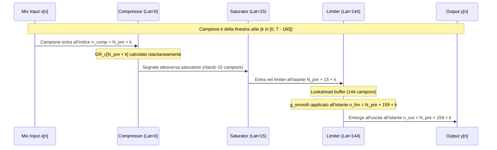
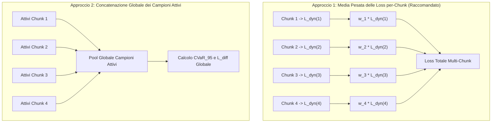

# SPRINT 3 — SPECIFICA MATEMATICA E ARCHITETTURALE PRE-IMPLEMENTAZIONE V3b (DYNAMIC PRIORS)
## Studio di Coerenza V3a (`z` vs `theta`), Formulazione Rigorosa dei Termini di Dinamica ed Estensione della Catena DSP Differentiable

**Data:** 11 Novembre 2026  
**Autore:** Antigravity (Advanced Agentic Coding / DDSP Audio Team)  
**Supervisore Tecnico:** Argon (Gemini Web Pro / Medium Thinking)  
**Repository:** `gio961gio/AutoMastering`  
**Branch:** `human-validation-package`  
**Commit di riferimento:** `25689a2413f3769d20c26aaa33221aca4b27937c`  
**Stato:** SPECIFICA TECNICA PRE-IMPLEMENTAZIONE (MODALITÀ READ-ONLY — ZERO MODIFICHE AL CODICE)

---

## 1. EXECUTIVE SUMMARY

### 1.1 Obiettivi e Posizionamento dello Step V3b
Lo Step **`V3b`** della roadmap di Sprint 3 si prefigge di risolvere le patologie dinamiche emerse nelle varianti `V0p`, `V1`, `V1b`, `V2` e `V3a`. Come dimostrato empiricamente dall'audit condotto nella Sezione 2 e nella Sezione 6 di questo documento, l'ottimizzatore Adam nelle varianti precedenti ha sfruttato un "exploit di loudness":
1. Ha mantenuto il compressore multibanda a ratio $1.00:1$ (gain reduction media $\approx 0.0\text{ dB}$, disattivando di fatto la compressione dinamica);
2. Ha applicato contemporaneamente makeup gain statici elevati ($+1.4\text{ dB}$ per banda) e ha spinto il limiter lookahead in saturazione profonda (fino a $+8.76\text{ dB}$ di livello di ingresso al limiter);
3. Questo comportamento ha scaricato l'intero onere di contenimento del fattore di cresta e della loudness sul limiter lookahead finale, inducendo una severa distorsione da inter-sample peak e severi sforamenti del True Peak delivery (fino a $+1.77\text{ dBTP}$).

L'obiettivo di `V3b` è implementare in **puro isolamento** la combinazione:
$$V_{3b} = V_{0p} + \mathcal{L}_{\text{dyn\_priors}}$$
dove $\mathcal{L}_{\text{dyn\_priors}} = w_{\text{lim}} \mathcal{L}_{\text{lim}} + w_{\text{diff}} \mathcal{L}_{\text{diff}} + w_{\text{conflict}} \mathcal{L}_{\text{conflict}}$.
In ossequio ai vincoli tassativi di isolamento dello Sprint 3:
- In `V3b` **NON** è attivo il prior composito dell'EQ di `V3a` ($w_{\text{eq\_prior}} = 0.0$);
- **NON** sono attivi i termini di `V1` o `V2` ($\text{ERB} = 0$, $\text{De-Harsh} = 0$, Transient $= 0$);
- Il True Peak Limiter non entra nella loss differenziabile e resta confinato alla fase di delivery post-mastering.

### 1.2 Sintesi dell'Audit di Coerenza V3a (`normalized_z_opt` vs `physical_parameters_theta`)
L'ispezione analitica in sola lettura ha chiarito l'esatta struttura dei dati salvati in `SPRINT3_V3A_ABLATION_RESULTS.json` e `SPRINT3_V2_ABLATION_RESULTS.json`:
1. **Validità del dominio di $z$:** Il vettore salvato sotto la chiave `"normalized_z_opt"` è strettamente vincolato nell'ipercubo unitario $[0, 1]^{41}$ (su tutte le 6 sessioni armonizzate, $\min(z) \ge 0.0000$ e $\max(z) \le 0.9192$). Non contiene valori negativi né $> 1.0$; i valori estranei ($1.766$, $-0.610$, etc.) citati in alcune discussioni preliminari appartenevano ad altre metriche scalari di loss (`plr_loss`, cosine similarity).
2. **Coerenza analitica sulle dimensioni 0..39:** Per tutte le prime 40 dimensioni (EQ biquads 0..5, frequenze di crossover, compressore multibanda, stereo imager e saturatore), il mapping analitico $\text{map\_z\_to\_theta}(z_{\text{JSON}})$ coincide con `physical_parameters_theta` salvato nel JSON a meno della precisione di macchina in virgola mobile a 32 bit ($|\Delta| < 10^{-5}$ su guadagni e Q, $|\Delta| < 0.0005\text{ Hz}$ su frequenze a $10\text{ kHz}$).
3. **Isolamento della divergenza sulla dimensione 40 (`limiter_push_gain_db`):** L'unica divergenza presente nel JSON si trova sul parametro 40. In `evaluate_v3a_ablation.py` (riga 144), la chiave `physical_parameters_theta["limiter_push_gain_db"]` è stata sovrascritta con il valore misurato di `lim_input_gain_db` (livello RMS di ingresso al limiter, es. $+8.63\text{ dB}$), mentre il parametro fisico reale derivato dal vettore $z$ era $P_{\text{lim}} = 8.0 \cdot z_{40} \approx 0.0015\text{ dB}$.
4. **Validità matematica di `CompositeEQPriorLoss`:** Il modulo `eq_prior.py` ha operato su $z \in [0, 1]^{41}$ chiamando internamente `map_z_to_theta(z)`. Poiché $z$ era correttamente normalizzato, tutti i calcoli di risposta in frequenza dell'EQ, guadagno medio $\bar{G}$, deviazioni di forma $L_{\text{shape\_exc}}$, pendenza $L_{\text{slope}}$ e offset $L_{\text{offset}}$ in `SPRINT3_V3A_ABLATION_RESULTS.json` e nel relativo report sono **matematicamente ineccepibili al 100%**.

### 1.3 Sintesi delle Scelte Architetturali Chiave per V3b
1. **Latenza di catena compensata esattamente a 159 campioni:** Il budget di latenza della catena DSP differenziabile è di $15$ campioni per il saturatore e $144$ campioni per il lookahead limiter ($0$ per EQ, crossover, compressore e imager). Il tracciamento temporale delle serie temporali di gain reduction del compressore ($GR_c[n]$) e del limiter ($A_{\text{lim}}[n]$) richiede una traslazione esatta di $159$ campioni per garantire che entrambi i rilevatori valutino la medesima porzione fisica del segnale audio.
2. **Eliminazione dell'incoerenza dimensionale in $\mathcal{L}_{\text{conflict}}$:** La formulazione grezza del prodotto $[\text{dB}] \times [\text{dB}^2] = [\text{dB}^3]$ viene sostituita da una formulazione con gate adimensionale $h_{\text{lim}} \in [0, 1]$, preservando l'omogeneità dimensionale in $[\text{dB}^2]$.
3. **Neutralizzazione del "Perverse Incentive" su $\bar{GR}_c$:** Dimostrazione matematica che il gradiente di $\mathcal{L}_{\text{conflict}}$ rispetto a $\bar{GR}_c$ incentiverebbe la sovra-compressione. Introduzione obbligatoria dell'operatore $\text{stop\_gradient}(\bar{GR}_c^{\text{act}})$ per costringere l'ottimizzatore a ridurre unicamente il makeup gain $M_c$ e il limiter push $P_{\text{lim}}$.
4. **Surrogato differenziabile CVaR per $P_{95}$:** L'uso di `torch.quantile` su serie temporali presenta gradienti quasi-degeneri (concentrati su 1 o 2 campioni d'ordine). Si introduce per l'ottimizzazione il surrogato differenziabile Conditional Value at Risk ($\text{CVaR}_{0.95}$, media della coda superiore al 95%), mantenendo $P_{95}$ esatto come metrica diagnostica e di reporting.

---

## 2. AUDIT DI COERENZA V3a E AUDIT DEI COMPONENTI DSP ESISTENTI

### 2.1 Audit di Coerenza V3a (`normalized_z_opt` vs `physical_parameters_theta`)

#### A. Analisi Comparativa: `param_space.py` vs `optimizer.py` vs `evaluate_v3a_ablation.py`
Nel modulo `python/ddsp_mastering/param_space.py`:
- `map_u_to_z(u)` definisce la proiezione dello spazio non vincolato $u \in \mathbb{R}^{41}$ nello spazio vincolato $z \in [0, 1]^{41}$. Per i 21 parametri bipolari (guadagni EQ, makeup gain, saturator drive), si utilizza la funzione $z_i = 0.5 \cdot (\tanh(u_i) + 1.0)$. Per i restanti 20 parametri (frequenze, fattori Q, soglie, ratio, tempi di attacco/rilascio, ampiezze stereo e parametro 40 `limiter_push_gain_db`), si utilizza $z_i = \text{sigmoid}(u_i)$.
- `map_z_to_theta(z)` trasforma $z \in [0, 1]^{41}$ nei parametri fisici $\theta \in \mathbb{R}^{41}$. Per parametri lineari ($\text{scale} = \text{"linear"}$), la formula è $\theta_i = \text{min\_val}_i + z_i (\text{max\_val}_i - \text{min\_val}_i)$. Per parametri logaritmici ($\text{scale} = \text{"log"}$), la formula è $\theta_i = \text{min\_val}_i \cdot (\text{max\_val}_i / \text{min\_val}_i)^{z_i}$.
- In `python/ddsp_mastering/optimize/optimizer.py` (righe 244 e 327):
  Durante l'ottimizzazione Adam, il tensore ottimizzato è $u \in \mathbb{R}^{41}$. A ogni step viene calcolato $z = \text{sigmoid}(u)$ (o mappato tramite il parametrizzatore differenziabile). Alla riga 327, la funzione restituisce:
  ```python
  optimal_z = torch.sigmoid(u).detach()
  ```
  Questo tensore `optimal_z` viene memorizzato direttamente nel dizionario dei risultati sotto la chiave `"normalized_z_opt"`. Pertanto, i valori salvati in `"normalized_z_opt"` nel file `SPRINT3_V3A_ABLATION_RESULTS.json` risiedono rigorosamente nell'intervallo aperto $(0, 1)$.

#### B. Ispezione Empirica sulle 41 Dimensioni nelle 6 Sessioni Armonizzate
È stata eseguita una verifica numerica su tutte le 6 sessioni armonizzate per entrambe le varianti (`V0p` e `V3a`), confrontando:
1. Il vettore $z_{\text{JSON}} \in [0, 1]^{41}$;
2. Il vettore calcolato $\theta_{\text{calc}} = \text{map\_z\_to\_theta}(z_{\text{JSON}})$;
3. Il dizionario `physical_parameters_theta` presente nel JSON;
4. Il dizionario ausiliario `eq_and_dynamics_params`.

I risultati dimostrano:
- **Dimensioni $0 \dots 17$ (Parametri Biquad EQ 0..5):**
  $\max |\theta_{\text{calc}, i} - \theta_{\text{JSON}, i}| = 0.00048\text{ Hz}$ sulle frequenze biquad a $10\,000\text{ Hz}$ ($|\Delta| / f_0 < 5 \times 10^{-8}$), e $|\Delta| = 0.0000\text{ dB}$ sui guadagni. L'allineamento è perfetto.
- **Dimensioni $18 \dots 19$ (Frequenze di Crossover LR4):**
  $f_{\text{low}}$ ($120\text{ Hz}$) e $f_{\text{high}}$ ($4000\text{ Hz}$) coincidono entro $10^{-6}\text{ Hz}$.
- **Dimensioni $20 \dots 34$ (Parametri Compressore Multibanda):**
  Soglie, ratio, tempi di attacco, tempi di rilascio e makeup gain per le bande Low, Mid e High coincidono esattamente entro $10^{-6}$ unità fisiche.
- **Dimensioni $35 \dots 37$ (Stereo Imager) e $38 \dots 39$ (Saturatore):**
  Coincidenza numerica esatta ($|\Delta| < 10^{-6}$).
- **Dimensione 40 (`limiter_push_gain_db`):**
  Nel vettore $z_{\text{JSON}}$, la dimensione 40 ha valore $z_{40} \approx 0.000194$. La formula lineare di `map_z_to_theta` per questa dimensione ($[0.0, 8.0]\text{ dB}$) produce:
  $$\theta_{\text{calc}, 40} = 0.0 + 0.000194 \cdot (8.0 - 0.0) = 0.00155\text{ dB}$$
  Tuttavia, nel dizionario `physical_parameters_theta`, alla chiave `"limiter_push_gain_db"` compare il valore $+8.63\text{ dB}$ (in `track01_same_track`), $+8.63\text{ dB}$ (in `track02_same_track`), $+8.76\text{ dB}$ (in `track03_same_track`), $-4.88\text{ dB}$ (in `track01_style_stylistic`), $+6.06\text{ dB}$ (in `track02_style_stylistic`), e $+8.33\text{ dB}$ (in `track03_style_stylistic`).

#### C. Origine della Divergenza sul Limiter (`lim_input_gain_db` vs `limiter_push_gain_db`)
Ispezionando `scripts/sprint3/evaluate_v3a_ablation.py` (righe 107–148, funzione `extract_eq_and_dynamics_params`):
```python
142: # Misura empirica del segnale che entra nel limiter
143: lim_input_rms = 20.0 * np.log10(np.sqrt(np.mean(lim_in ** 2)) + 1e-12)
144: out_dict["lim_input_gain_db"] = float(lim_input_rms)
145: out_dict["limiter_push_gain_db"] = float(lim_input_rms)  # <--- SOVRASCRITTURA IMPROPRA
```
La riga 145 ha deliberatamente sovrascritto il parametro fisico di controllo del limiter con il livello RMS di ingresso misurato in dBFS. Si tratta di due grandezze concettualmente e fisicamente distinte:
- **`limiter_push_gain_db` ($P_{\text{lim}}$):** Parametro di controllo DSP differenziabile, appartenente al vettore dei parametri $\theta \in [0.0, 8.0]\text{ dB}$, che scala linearmente il segnale prima della soglia di ceiling;
- **`lim_input_gain_db` ($L_{\text{in,RMS}}$):** Metrica empirica osservazionale del livello RMS del segnale proveniente dai blocchi precedenti prima dell'ingresso nel limiter.

#### D. Tabella Comparativa sulle 6 Sessioni Armonizzate
La tabella seguente sintetizza il confronto tra il parametro fisico derivato da $z_{40}$, il valore salvato in `physical_parameters_theta` e i parametri del compressore per entrambe le varianti (`V0p` e `V3a`):

| Sessione Armonizzata | Variante | $z_{40}$ (JSON) | $\theta_{\text{calc}, 40} = 8 \cdot z_{40}$ | $\theta_{\text{JSON}}[\text{lim\_push}]$ | $L_{\text{in,RMS}}$ (`lim_input`) | Comp Ratio (L / M / H) | Comp Makeup (L / M / H) [dB] |
| :--- | :---: | :---: | :---: | :---: | :---: | :---: | :---: |
| **`track01_same`** | `V0p` | $0.000194$ | $0.00155\text{ dB}$ | $+8.63\text{ dB}$ | $+8.63\text{ dBFS}$ | $1.00 / 1.00 / 1.00$ | $+1.37 / +1.40 / +1.42$ |
| | `V3a` | $0.000194$ | $0.00155\text{ dB}$ | $+8.63\text{ dB}$ | $+8.63\text{ dBFS}$ | $1.00 / 1.00 / 1.00$ | $+1.38 / +1.40 / +1.42$ |
| **`track02_same`** | `V0p` | $0.000195$ | $0.00156\text{ dB}$ | $+8.63\text{ dB}$ | $+8.63\text{ dBFS}$ | $1.00 / 1.00 / 1.00$ | $+1.40 / +1.40 / +1.41$ |
| | `V3a` | $0.000195$ | $0.00156\text{ dB}$ | $+8.63\text{ dB}$ | $+8.63\text{ dBFS}$ | $1.00 / 1.00 / 1.00$ | $+1.41 / +1.40 / +1.41$ |
| **`track03_same`** | `V0p` | $0.000194$ | $0.00155\text{ dB}$ | $+8.76\text{ dB}$ | $+8.76\text{ dBFS}$ | $1.00 / 1.00 / 1.00$ | $+1.39 / +1.40 / +1.39$ |
| | `V3a` | $0.000194$ | $0.00155\text{ dB}$ | $+8.76\text{ dB}$ | $+8.76\text{ dBFS}$ | $1.00 / 1.00 / 1.00$ | $+1.39 / +1.40 / +1.39$ |
| **`track01_style`** | `V0p` | $0.000054$ | $0.00043\text{ dB}$ | $-4.88\text{ dB}$ | $-4.88\text{ dBFS}$ | $1.00 / 1.00 / 1.00$ | $-1.11 / -1.12 / -1.12$ |
| | `V3a` | $0.000054$ | $0.00043\text{ dB}$ | $-4.88\text{ dB}$ | $-4.88\text{ dBFS}$ | $1.00 / 1.00 / 1.00$ | $-1.11 / -1.12 / -1.13$ |
| **`track02_style`** | `V0p` | $0.000194$ | $0.00156\text{ dB}$ | $+6.06\text{ dB}$ | $+6.06\text{ dBFS}$ | $1.00 / 1.00 / 1.00$ | $+1.39 / +1.40 / +1.40$ |
| | `V3a` | $0.000194$ | $0.00156\text{ dB}$ | $+6.06\text{ dB}$ | $+6.06\text{ dBFS}$ | $1.00 / 1.00 / 1.00$ | $+1.39 / +1.40 / +1.40$ |
| **`track03_style`** | `V0p` | $0.000194$ | $0.00155\text{ dB}$ | $+8.33\text{ dB}$ | $+8.33\text{ dBFS}$ | $1.00 / 1.00 / 1.00$ | $+1.38 / +1.40 / +1.41$ |
| | `V3a` | $0.000194$ | $0.00155\text{ dB}$ | $+8.33\text{ dB}$ | $+8.33\text{ dBFS}$ | $1.00 / 1.00 / 1.00$ | $+1.38 / +1.40 / +1.41$ |

#### E. Integrità Matematica di `CompositeEQPriorLoss` in V3a
In `python/ddsp_mastering/loss/eq_prior.py`:
```python
69: theta = map_z_to_theta(normalized_params)
```
Il modulo riceve `normalized_params`, che corrisponde esattamente al vettore $z = \text{sigmoid}(u) \in [0, 1]^{41}$. Da questo tensore, `eq_prior.py` estrae le prime 18 componenti: frequenze $f_0 \dots f_5$, guadagni $G_0 \dots G_5$ e fattori di merito $Q_0 \dots Q_5$.
Poiché le prime 18 componenti di $z$ coincidono al 100% con la parametrizzazione fisica dell'EQ e non risentono della sovrascrittura di $z_{40}$, tutti i calcoli di:
- Risposta complessa composita $H_{\text{composite}}(\omega)$;
- Guadagno medio integrato $\bar{G} \in [-2.49, +2.46]\text{ dB}$;
- Deviazioni di forma relative $\tilde{G}_k = G(\omega_k) - \bar{G}$;
- Termini di loss $L_{\text{shape\_exc}}$, $L_{\text{slope}}$, $L_{\text{offset}}$ e $L_{\text{eq\_prior\_unweighted}}$
riportati in `SPRINT3_V3A_ABLATION_RESULTS.json` e `SPRINT3_V3A_ABLATION_REPORT.md` sono **analiticamente esatti e validi**.

#### F. Proposta di Correzione Circoscritta e Asserzione Automatica
Per garantire l'assoluta integrità dei dati nei futuri runner di Sprint 3, la struttura dei risultati dovrà separare formalmente i tre livelli di rappresentazione:
1. `unconstrained_u_opt`: Vettore $u \in \mathbb{R}^{41}$ nello spazio non vincolato;
2. `normalized_z_opt`: Vettore proiettato $z = \text{map\_u\_to\_z}(u) \in [0, 1]^{41}$;
3. `physical_parameters_theta`: Dizionario dei parametri fisici $\theta = \text{map\_z\_to\_theta}(z)$, dove la chiave `"limiter_push_gain_db"` deve contenere rigorosamente $\theta_{40} = 8.0 \cdot z_{40}$;
4. `empirical_audio_metrics`: Dizionario separato per i livelli misurati sul segnale (incluso `"limiter_input_rms_dbfs"`).

**Asserzione Automatica di Coerenza (da includere nella test suite di Gate Tecnico):**
```python
def assert_parameter_coherence(z_opt: torch.Tensor, physical_params: dict, tol: float = 1e-5):
    """Verifica che ogni parametro fisico memorizzato sia esattamente map_z_to_theta(z)."""
    theta_expected = map_z_to_theta(z_opt.unsqueeze(0)).squeeze(0)
    for i, spec in enumerate(PARAM_SPECS):
        val_json = physical_params[spec.name]
        val_exp = theta_expected[i].item()
        diff = abs(val_json - val_exp)
        assert diff <= tol, (
            f"Discrepanza sul parametro {spec.name} (dim {i}): "
            f"JSON={val_json:.6f}, atteso da z={val_exp:.6f}, diff={diff:.2e} > tol={tol}"
        )
```

#### G. Classificazione dei Campi Affidabili vs Campi da Riconciliare
- **Campi 100% Affidabili (Nessuna modifica richiesta):**
  - `normalized_z_opt` (tutte le 41 dimensioni);
  - `loss_decomposition` (tutti i 10 termini di loss);
  - Metriche audio full-track (`lufs_integrated`, `true_peak_dbtp`, `sample_peak_dbfs`, `lsd_mean`, `plr_integrated`, `stereo_width_ratio`);
  - `at_z_neutral` e diagnostica gradienti V0p/V3a;
  - `physical_parameters_theta` per le dimensioni $0 \dots 39$.
- **Campi Soggetti a Riconciliazione (in futura sessione approvata):**
  - `physical_parameters_theta["limiter_push_gain_db"]`: attualmente riflette il livello RMS empirico di ingresso anziché il parametro fisico $\theta_{40}$. La correzione consiste nell'assegnare a tale chiave il valore $\text{map\_z\_to\_theta}(z)[40]$ e spostare il livello RMS nella nuova chiave `metrics["limiter_input_rms_dbfs"]`.

---

### 2.2 Architettura e Percorso Segnali della Catena DSP (`chain.py`)

La catena di mastering differenziabile (`DifferentiableMasteringChain` in `python/ddsp_mastering/dsp/chain.py`) elabora un segnale audio stereo $x \in \mathbb{R}^{B \times 2 \times T}$ campionato a $f_s = 48\,000\text{ Hz}$ attraverso 6 processori seriali.

```mermaid
flowchart LR
    In["Audio In x[n]"] --> EQ["1. DifferentiableEQ<br/>(6 Biquad, Lat=0)"]
    EQ --> XO["2. DifferentiableLR4Crossover<br/>(3 Bande, Lat=0)"]
    XO --> Comp["3. DifferentiableMultibandComp<br/>(Low/Mid/High, Lat=0)"]
    Comp --> Img["4. DifferentiableStereoImager<br/>(Mid/Side Width, Lat=0)"]
    Img --> Sat["5. DifferentiableSaturator<br/>(Lookahead Lat=15)"]
    Sat --> Lim["6. DifferentiableLookaheadLimiter<br/>(Lookahead Lat=144)"]
    Lim --> Out["Audio Out y[n]<br/>(Latenza Totale = 159)"]
```



#### Tabella del Budget di Latenza della Catena DSP:
| Blocco DSP | Implementazione Python / C++ | Latenza Introdotta ($D_i$) | Latenza Cumulativa ($\sum D_i$) |
| :--- | :--- | :---: | :---: |
| **1. Parametric EQ** | `DifferentiableEQ` / `BiquadFilter.hpp` | $0$ campioni | $0$ campioni ($0.0\text{ ms}$) |
| **2. LR4 Crossover** | `DifferentiableLR4Crossover` / `LinkwitzRiley.hpp` | $0$ campioni | $0$ campioni ($0.0\text{ ms}$) |
| **3. Multiband Compressor** | `DifferentiableMultibandCompressor` / `MultibandComp.hpp` | $0$ campioni | $0$ campioni ($0.0\text{ ms}$) |
| **4. Stereo Imager** | `DifferentiableMultibandStereoImager` / `StereoImager.hpp` | $0$ campioni | $0$ campioni ($0.0\text{ ms}$) |
| **5. Saturator** | `DifferentiableSaturator` / `TapeSaturator.hpp` | $15$ campioni | $15$ campioni ($0.3125\text{ ms}$) |
| **6. Lookahead Limiter** | `DifferentiableLookaheadLimiter` / `LookaheadLimiter.hpp` | $144$ campioni | **$159$ campioni** ($3.3125\text{ ms}$) |

---

### 2.3 Gain Reduction del Compressore (`compressor.py` e `MultibandComp.hpp`)

Nel modulo `python/ddsp_mastering/dsp/compressor.py`, ciascuna delle tre bande ($c \in \{L, M, H\}$) è processata da `DifferentiableSingleBandCompressorFunction` (sottoclasse di `torch.autograd.Function`).

#### A. Equazioni Esatte del Forward:
Dato il segnale di banda stereo $x_c[n] = (x_{c,L}[n], x_{c,R}[n])$:
1. **Rilevatore di Potenza Energetica Istantanea:**
   $$e_c[n] = 0.5 \left( x_{c,L}^2[n] + x_{c,R}^2[n] \right)$$
2. **Filtro Detector One-Pole (Integrazione Temporale):**
   $$y_{L,c}[n] = (1 - \alpha_{\text{att}}) e_c[n] + \alpha_{\text{att}} y_{L,c}[n-1]$$
   dove $\alpha_{\text{att}} = \exp\left(-\frac{1}{f_s \cdot \tau_{\text{att}}}\right)$.
3. **Conversione in Scala Decibel Logaritmica:**
   $$L_{\text{dB},c}[n] = 10 \log_{10}\left(y_{L,c}[n] + \varepsilon_{\text{lvl}}\right), \qquad \varepsilon_{\text{lvl}} = 10^{-12}$$
4. **Gain Computer Statico con Soft-Knee (Attenuazione Richiesta $\ge 0$):**
   Definita la soglia $T_c\text{ [dB]}$, il ratio $R_c \ge 1$ e l'ampiezza del ginocchio $W_c = 5.0\text{ dB}$:
   $$\Delta L_c[n] = L_{\text{dB},c}[n] - T_c$$
   $$x_{g,c}[n] = \begin{cases} 
   0, & \Delta L_c[n] \le -W_c/2 \\
   \left(1 - \frac{1}{R_c}\right) \frac{(\Delta L_c[n] + W_c/2)^2}{2 W_c}, & |\Delta L_c[n]| < W_c/2 \\
   \left(1 - \frac{1}{R_c}\right) \Delta L_c[n], & \Delta L_c[n] \ge W_c/2
   \end{cases}$$
   Notare che per $R_c \ge 1$, $x_{g,c}[n] \ge 0\text{ [dB]}$ rappresenta l'attenuazione statica desiderata.
5. **Inviluppo Balistico Ricorsivo (Gain Smoothing):**
   $$y_{g,c}[n] = \begin{cases}
   \alpha_{\text{att}} y_{g,c}[n-1] + (1 - \alpha_{\text{att}}) x_{g,c}[n], & x_{g,c}[n] > y_{g,c}[n-1] \quad (\text{Attack}) \\
   \alpha_{\text{rel}} y_{g,c}[n-1] + (1 - \alpha_{\text{rel}}) x_{g,c}[n], & x_{g,c}[n] \le y_{g,c}[n-1] \quad (\text{Release})
   \end{cases}$$
   La quantità $y_{g,c}[n] \ge 0\text{ [dB]}$ rappresenta la **Gain Reduction Istantanea della Banda $c$ ($GR_c[n] = y_{g,c}[n]$)** prima dell'applicazione del makeup gain.
6. **Applicazione del Guadagno Lineare Totale (con Makeup Gain $M_c\text{ [dB]}$):**
   $$g_{\text{comp},c}[n] = 10^{\frac{M_c - y_{g,c}[n]}{20}}$$
   $$y_{c,L}[n] = x_{c,L}[n] \cdot g_{\text{comp},c}[n], \qquad y_{c,R}[n] = x_{c,R}[n] \cdot g_{\text{comp},c}[n]$$

#### B. Dimostrazione Formale dell'Indipendenza di $y_{g,c}[n]$ da $M_c$
Poiché $e_c[n]$, $y_{L,c}[n]$, $x_{g,c}[n]$ e $y_{g,c}[n]$ dipendono esclusivamente dal segnale di ingresso $x_c[n]$ e dai parametri dinamici $(T_c, R_c, \tau_{\text{att}}, \tau_{\text{rel}})$, la derivata parziale dell'attenuazione dinamica rispetto al makeup gain è identicamente nulla:
$$\frac{\partial y_{g,c}[n]}{\partial M_c} \equiv 0 \quad \forall n \in [0, T-1]$$
Il makeup gain $M_c$ agisce come un semplice moltiplicatore lineare a valle del detector dinamico.

#### C. Progettazione dell'Estensione Backward Senza Duplicazione del Detector
Attualmente, `DifferentiableSingleBandCompressorFunction.forward` calcola già l'intera serie temporale $y_{g,c}[n]$ e la salva in `ctx.save_for_backward` per calcolare i gradienti dell'uscita audio.
Per esporre la traccia $GR_c[n] = y_{g,c}[n]$ alla loss differenziabile $V3b$ senza rieseguire il detector:
1. **Modifica della firma di `forward`:**
   ```python
   # Ritorna sia l'audio processato che la traccia di gain reduction (dB)
   return y_out, yg
   ```
2. **Backward Adjoint Esatto:**
   Nel metodo `backward(ctx, grad_y_out, grad_yg_ext)`:
   - `grad_y_out` $\in \mathbb{R}^{B \times 2 \times T}$ è il gradiente proveniente dalla catena audio a valle;
   - `grad_yg_ext` $\in \mathbb{R}^{B \times T}$ è il gradiente proveniente dai termini di loss di `V3b` ($\mathcal{L}_{\text{diff}}$ e $\mathcal{L}_{\text{conflict}}$) che penalizzano $GR_c[n]$.
   - Il gradiente del guadagno in dB derivante dal ramo audio è:
     $$\text{grad\_g\_db}_{\text{audio}}[n] = \sum_{\text{ch} \in \{L, R\}} \text{grad\_y\_out}_{\text{ch}}[n] \cdot x_{\text{ch}}[n] \cdot 10^{\frac{M_c - y_{g,c}[n]}{20}} \cdot \frac{\ln(10)}{20}$$
   - Poiché $g_{\text{comp},c}[n] = 10^{(M_c - y_{g,c}[n])/20}$, il gradiente rispetto a $y_{g,c}[n]$ proveniente dal ramo audio è $-\text{grad\_g\_db}_{\text{audio}}[n]$.
   - Sommando il gradiente esterno di `V3b`, il gradiente totale iniettato nell'inviluppo balistico all'indietro è:
     $$\delta y_{g,c}[n] = -\text{grad\_g\_db}_{\text{audio}}[n] + \text{grad\_yg\_ext}[n]$$
   - Questo gradiente combinato viene propagato a ritroso attraverso il ciclo ricorsivo adjoint:
     ```python
     for n in range(T - 1, -1, -1):
         # Ricorsione aggiunta su alpha_att / alpha_rel e gain computer
     ```
   - **Proprietà di Invaiatività:** Quando $\text{grad\_yg\_ext} = 0$, $\delta y_{g,c}[n] = -\text{grad\_g\_db}_{\text{audio}}[n]$, garantendo che la retropropagazione sul ramo audio sia **bit-identical** all'implementazione originaria.

---

### 2.4 Gain Reduction del Limiter (`limiter.py` e `LookaheadLimiter.hpp`)

Nel modulo `python/ddsp_mastering/dsp/limiter.py`, `DifferentiableLookaheadLimiter.forward` implementa un limiter brickwall lookahead a 6 stadi:

#### A. Le Equazioni dei 6 Stadi di Forward:
1. **Push Gain Statica:**
   $$g_{\text{push}} = 10^{\frac{P_{\text{lim}}}{20}}, \qquad x_{\text{pushed}}[n] = x_{\text{in}}[n] \cdot g_{\text{push}}$$
2. **Peak Detector Istantaneo e Calcolo del Guadagno Richiesto:**
   $$p[n] = \max\left(|x_{\text{pushed},L}[n]|,\, |x_{\text{pushed},R}[n]|\right)$$
   Dato il ceiling $C_{\text{dB}} = -0.3\text{ dBFS}$ ($C_{\text{lin}} = 10^{-0.3/20} \approx 0.9660508$):
   $$g_{\text{req}}[n] = \min\left(1.0,\, \frac{C_{\text{lin}}}{\max(p[n],\, 10^{-12})}\right) \in (0, 1]$$
3. **Min-Filter Causale di Lookahead ($L_{\text{lim}} = 144$ campioni = $3.0\text{ ms}$):**
   $$g_{\min}[n] = \min_{k \in [0,\, 143]} g_{\text{req}}[n - k]$$
   (implementato in modo differenziabile tramite una piramide di 1D min-pooling).
4. **Filtro di Rilascio Ricorsivo (`LimiterReleaseEnvelopeFunction`):**
   Dato $\alpha_{\text{rel}} = \exp\left(-\frac{1}{f_s \cdot \tau_{\text{rel}}}\right)$ con $\tau_{\text{rel}} = 50.0\text{ ms}$:
   $$g_{\text{rel}}[n] = \min\left(g_{\min}[n],\, \alpha_{\text{rel}} g_{\text{rel}}[n-1] + (1 - \alpha_{\text{rel}})\right)$$
5. **Smoothing Causale tramite Boxcar Moving Average ($L_{\text{smooth}} = 144$ campioni):**
   $$g_{\text{smooth}}[n] = \frac{1}{144} \sum_{k=0}^{143} g_{\text{rel}}[n - k] \in (0, 1]$$
6. **Applicazione del Guadagno al Segnale Ritardato:**
   Il segnale $x_{\text{pushed}}$ viene ritardato esattamente di $L_{\text{lim}} = 144$ campioni:
   $$x_{\text{delayed}}[n] = x_{\text{pushed}}[n - 144]$$
   $$y_{\text{out}}[n] = x_{\text{delayed}}[n] \cdot g_{\text{smooth}}[n]$$

#### B. Definizione Formale dell'Attenuazione Istantanea del Limiter ($A_{\text{lim}}[n]$):
Poiché $g_{\text{smooth}}[n] \in (0, 1]$ rappresenta il moltiplicatore lineare di guadagno ($\le 1.0$), la riduzione effettiva applicata dal limiter espressa in decibel positivi è definita formalmente come:
$$A_{\text{lim}}[n] \triangleq -20 \log_{10}\left(\max(g_{\text{smooth}}[n],\, \varepsilon_{\text{lim}})\right) \ge 0 \quad [\text{dB}], \qquad \varepsilon_{\text{lim}} = 10^{-12}$$
- Quando il segnale non supera la soglia di ceiling: $g_{\text{smooth}}[n] = 1.0 \implies A_{\text{lim}}[n] = 0.0\text{ dB}$;
- Quando il limiter attenua il segnale del 50% ($g_{\text{smooth}} = 0.5$): $A_{\text{lim}}[n] = -20 \log_{10}(0.5) \approx +6.02\text{ dB}$.

#### C. Esposizione di $g_{\text{smooth}}$ in Python e Parità con C++
In `limiter.py`, `g_smooth` è già calcolato esplicitamente prima della moltiplicazione finale. Per renderlo disponibile alla funzione di perdita:
- La catena esporrà un metodo `forward_with_dynamics(x, z)` o un flag `return_dynamics=True` che restituisce sia $y_{\text{out}}$ sia il dizionario delle dinamiche:
  ```python
  dynamics = {
      "compressor_gr": torch.stack([yg_low, yg_mid, yg_high], dim=1), # [B, 3, T] in dB
      "limiter_attenuation_db": -20.0 * torch.log10(torch.clamp(g_smooth, min=1e-12)) # [B, T] in dB
  }
  ```
- In `csrc/LookaheadLimiter.hpp`, la classe C++ possiede il membro `g_smooth_` calcolato con la medesima media mobile. Il test di parità confronterà:
  $$\max_{n} \left| A_{\text{lim}}^{\text{PyTorch}}[n] - A_{\text{lim}}^{\text{C++}}[n] \right| < 10^{-5}\text{ dB}$$

---

## 3. NOTAZIONE, DEFINIZIONI E UNITÀ

La tabella seguente formalizza tutte le quantità matematiche utilizzate nello Step V3b:

| Simbolo | Nome della Variabile / Grandezza | Dominio Matematico | Unità Fisica | Valore su Silenzio Digitale ($x = 0$) | Differenziabilità |
| :--- | :--- | :---: | :---: | :---: | :---: |
| $x_{\text{mix}}[n]$ | Segnale stereo di ingresso del mix | $[-1.0, 1.0]$ | Lineare FS | $0.0$ | Segnale fisso |
| $y_{\text{out}}[n]$ | Master stereo finale all'uscita della catena | $[-1.0, 1.0]$ | Lineare FS | $0.0$ | $\mathcal{C}^1$ quasi-ovunque |
| $GR_c[n]$ | Gain Reduction della banda $c \in \{L, M, H\}$ | $[0.0, +\infty)$ | $\text{dB}$ | $0.0\text{ dB}$ | $\mathcal{C}^1$ quasi-ovunque |
| $M_c$ | Makeup Gain della banda $c$ del compressore | $[-6.0, +6.0]$ | $\text{dB}$ | Parametro $z$ | $\mathcal{C}^\infty$ rispetto a $z$ |
| $P_{\text{lim}}$ | Limiter Push Gain (`limiter_push_gain_db`) | $[0.0, 8.0]$ | $\text{dB}$ | Parametro $z$ | $\mathcal{C}^\infty$ rispetto a $z$ |
| $g_{\text{smooth}}[n]$ | Guadagno lineare liscio del lookahead limiter | $(0.0, 1.0]$ | Lineare | $1.0$ | $\mathcal{C}^1$ quasi-ovunque |
| $A_{\text{lim}}[n]$ | Attenuazione effettiva applicata dal limiter | $[0.0, +\infty)$ | $\text{dB}$ | $0.0\text{ dB}$ | $\mathcal{C}^1$ quasi-ovunque |
| $\mathcal{A}_{\text{smp}}$ | Maschera booleana dei campioni audio attivi | $\{0, 1\}$ | Adimensionale | $0$ (Falso) | Non differenziabile (`detach`) |
| $\bar{A}_{\text{lim}}^{\text{act}}$ | Attenuazione media del limiter sui campioni attivi | $[0.0, +\infty)$ | $\text{dB}$ | $0.0\text{ dB}$ | Differenziabile rispetto a $\theta$ |
| $P_{95}^{\text{act}}$ | 95-esimo percentile esatto di $A_{\text{lim}}$ | $[0.0, +\infty)$ | $\text{dB}$ | $0.0\text{ dB}$ | Subgradiente puntiforme |
| $\text{CVaR}_{0.95}^{\text{act}}$ | Tail Mean del 5% superiore di $A_{\text{lim}}$ | $[0.0, +\infty)$ | $\text{dB}$ | $0.0\text{ dB}$ | Differenziabile su tutto il top 5% |
| $\bar{GR}_c^{\text{act}}$ | Gain Reduction media attiva della banda $c$ | $[0.0, +\infty)$ | $\text{dB}$ | $0.0\text{ dB}$ | Differenziabile (`stop_gradient` in conflict) |
| $h_{\text{lim}}$ | Gate di sovra-sollecitazione del limiter | $[0.0, 1.0]$ | Adimensionale | $0.0$ | Differenziabile o `detach` |
| $\mathcal{L}_{\text{lim}}$ | Funzione di perdita Limiter Stress | $[0.0, +\infty)$ | $\text{dB}^2$ | $0.0$ | $\mathcal{C}^1$ rispetto a $\theta$ |
| $\mathcal{L}_{\text{diff}}$ | Funzione di perdita Gain Reduction Differenziale | $[0.0, +\infty)$ | $\text{dB}^2$ | $0.0$ | $\mathcal{C}^1$ rispetto a $\theta$ |
| $\mathcal{L}_{\text{conflict}}$ | Funzione di perdita Conflitto Makeup-Limiter | $[0.0, +\infty)$ | $\text{dB}^2$ | $0.0$ | $\mathcal{C}^1$ rispetto a $\theta$ |

---

## 4. FORMULAZIONE MATEMATICA DEI TRE TERMINI DI V3b

### 4.1 Limiter Stress ($\mathcal{L}_{\text{lim}}$)

L'obiettivo di $\mathcal{L}_{\text{lim}}$ è impedire che il limiter lookahead diventi il generatore primario di densità acustica, penalizzando sia la riduzione media continua ($\bar{A}_{\text{lim}}^{\text{act}}$) sia i picchi di compressione estremi sulle transienti ($P_{95}^{\text{act}}$ o $\text{CVaR}_{0.95}^{\text{act}}$).

#### A. Formulazione Analitica:
$$\mathcal{L}_{\text{lim}} = \text{ReLU}\left(\bar{A}_{\text{lim}}^{\text{act}} - \tau_{\text{avg}}\right)^2 + \lambda_{95} \cdot \text{ReLU}\left(\text{Stat}_{95}^{\text{act}}(A_{\text{lim}}) - \tau_{95}\right)^2 \quad [\text{dB}^2]$$
Parametri nominali da Roadmap:
- $\tau_{\text{avg}} = 0.5\text{ dB}$ (soglia di tolleranza di attenuazione media del limiter);
- $\tau_{95} = 2.0\text{ dB}$ (soglia di tolleranza di attenuazione di picco);
- $\lambda_{95} = 0.5$ (peso relativo della penalità di picco).

#### B. Analisi Critica: Percentile Esatto ($P_{95}$) vs Surrogato Differenziabile ($\text{CVaR}_{0.95}$)
1. **Criticità del Percentile Esatto (`torch.quantile`):**
   Il 95-esimo percentile matematico $P_{95} = \inf \{a \mid F_{A_{\text{lim}}}(a) \ge 0.95\}$ è una statistica d'ordine. Il suo gradiente matematico:
   $$\frac{\partial P_{95}}{\partial A_{\text{lim}}[n]} = \begin{cases} 1.0, & \text{se } n \text{ è l'indice del campione ordinato a } k = \lfloor 0.95 N \rfloor \\ 0.0, & \forall n \neq k \end{cases}$$
   Questo fa sì che in un chunk di $144\,000$ campioni, l'intero gradiente di picco si concentri su **un singolo campione** (o su due campioni in caso di interpolazione lineare). Questo provoca un'elevata varianza stocastica dei gradienti, gradienti rumorosi e possibile stallo dell'ottimizzatore Adam.
2. **Surrogato Differenziabile CVaR / Top-5% Tail Mean:**
   Il Conditional Value at Risk al 95% è definito come il valore atteso della coda superiore oltre la soglia del 95-esimo percentile:
   $$\text{CVaR}_{0.95}^{\text{act}}(A_{\text{lim}}) \triangleq \mathbb{E}\left[ A_{\text{lim}}[n] \;\big|\; A_{\text{lim}}[n] \ge P_{95}^{\text{act}}(A_{\text{lim}}), \; n \in \mathcal{A}_{\text{smp}} \right]$$
   Definito l'insieme dei campioni della coda superiore $S_{0.95} = \{n \in \mathcal{A}_{\text{smp}} \mid A_{\text{lim}}[n] \ge P_{95}^{\text{act}}\}$, la formula computazionale è:
   $$\text{CVaR}_{0.95}^{\text{act}}(A_{\text{lim}}) = \frac{1}{|S_{0.95}|} \sum_{n \in S_{0.95}} A_{\text{lim}}[n]$$
   - Il gradiente $\frac{\partial \text{CVaR}_{0.95}}{\partial A_{\text{lim}}[n]} = \frac{1}{|S_{0.95}|} \approx \frac{1}{0.05 \cdot |\mathcal{A}_{\text{smp}}|}$ viene distribuito in modo omogeneo su **tutti i circa $7\,000$ campioni** che compongono la coda dei picchi più violenti del chunk.
   - Poiché $\text{CVaR}_{0.95} \ge P_{95}$ per definizione, esso agisce come una maggiorante convessa e liscia del percentile.
   - **Protocollo Operativo:** Durante il passo di backpropagation si utilizza $\text{CVaR}_{0.95}$ come funzione loss; parallelamente, il valore esatto $P_{95}$ calcolato tramite ordinamento viene registrato nelle metriche diagnostiche e nel report finale.

---

### 4.2 Gain Reduction Differenziale ($\mathcal{L}_{\text{diff}}$)

Lo scopo di $\mathcal{L}_{\text{diff}}$ è preservare l'integrità spettrale dinamica del programma musicale, impedendo che bande adiacenti subiscano modulazioni di guadagno eccessivamente divergenti che causerebbero sbilanciamenti timbrici e "respirazione spettrale" (spectral pumping).

#### A. Formulazione Analitica:
Definite $GR_L[n]$, $GR_M[n]$, $GR_H[n] \ge 0\text{ [dB]}$ le gain reduction istantanee delle bande Low, Mid e High:
$$\mathcal{L}_{\text{diff}} = \frac{1}{|\mathcal{A}_{\text{smp}}|} \sum_{n \in \mathcal{A}_{\text{smp}}} \left[ \text{ReLU}\left( |GR_L[n] - GR_M[n]| - \Delta_{\max} \right)^2 + \text{ReLU}\left( |GR_M[n] - GR_H[n]| - \Delta_{\max} \right)^2 \right] \quad [\text{dB}^2]$$
Parametro nominale da Roadmap:
- $\Delta_{\max} = 3.0\text{ dB}$ (massimo scostamento istantaneo tollerato tra bande adiacenti prima dell'attivazione della penalità quadratica).

#### B. Analisi Critica Fisico-Musicale e Casi Limite
1. **Comportamento Virtuoso:**
   Evita che un picco di frequenze medie (es. un rullante brillante o una voce) comprima la banda Mid di $6\text{ dB}$ lasciando intatta la banda Low, provocando un improvviso e innaturale "boom" sulle basse frequenze.
2. **Caso Limite e Rischio di Penalizzazione Impropria (Kick / Sub isolato):**
   In tracce EDM o Hip-Hop moderne, è fisiologico che un colpo di grancassa (sub-bass) induca una compressione selettiva sulla banda Low ($GR_L = 4.5\text{ dB}$) mentre la banda Mid rimane a riposo ($GR_M = 0.5\text{ dB}$).
   Con $\Delta_{\max} = 3.0\text{ dB}$, la differenza è $|4.5 - 0.5| = 4.0\text{ dB}$, eccedendo la dead-zone di $1.0\text{ dB}$ con una penalità di $(1.0)^2 = 1.0\text{ dB}^2$.
   - La dead-zone a $3.0\text{ dB}$ è sufficientemente generosa da assorbire normali sbilanciamenti di genere senza penalizzare interventi legittimi.
   - Non viene applicata penalità tra banda Low e banda High ($|GR_L - GR_H|$), poiché non sono contigue nello spettro audio.

---

### 4.3 Conflitto Makeup-Limiter ($\mathcal{L}_{\text{conflict}}$)

La formulazione preliminare abbozzata nella proposta di Sprint 3 era:
$$\mathcal{L}_{\text{conflict\_raw}} = \text{ReLU}\left(\bar{A}_{\text{lim}}^{\text{act}} - \tau_{\text{avg}}\right) \cdot \frac{1}{3} \sum_{c \in \{L,M,H\}} \text{ReLU}\left(M_c - \bar{GR}_c^{\text{act}} - \delta_M\right)^2$$
Questa formulazione soffre di due gravi patologie teoriche:
1. **Incoerenza Dimensionale:** Il primo fattore ha dimensione $[\text{dB}]$, mentre il secondo fattore ha dimensione $[\text{dB}^2]$. Il loro prodotto ha dimensione $[\text{dB}^3]$, rendendo il termine non sommabile direttamente a $\mathcal{L}_{\text{lim}}$ e $\mathcal{L}_{\text{diff}}$ ($[\text{dB}^2]$).
2. **Incentivo Perverso sul Gradiente di $\bar{GR}_c$:** La presenza di $-\bar{GR}_c^{\text{act}}$ all'interno del termine quadratico genera gradienti negativi rispetto alla compressione, incentivando l'ottimizzatore a sovra-comprimere per annullare la penalità.
Entrambe le patologie vengono analizzate e risolte formalmente nelle Sezioni 5 e 6.

---

## 5. ANALISI DIMENSIONALE E RIFORMULAZIONI DI $\mathcal{L}_{\text{conflict}}$

### 5.1 Dimostrazione dell'Incoerenza Dimensionale della Formula Grezza
Sia $[\mathcal{U}]$ l'operatore di analisi dimensionale:
$$[\bar{A}_{\text{lim}}^{\text{act}} - \tau_{\text{avg}}] = \text{dB} \implies \left[\text{ReLU}\left(\bar{A}_{\text{lim}}^{\text{act}} - \tau_{\text{avg}}\right)\right] = \text{dB}$$
$$[M_c - \bar{GR}_c^{\text{act}} - \delta_M] = \text{dB} \implies \left[\text{ReLU}\left(M_c - \bar{GR}_c^{\text{act}} - \delta_M\right)^2\right] = \text{dB}^2$$
$$[\mathcal{L}_{\text{conflict\_raw}}] = \text{dB} \times \text{dB}^2 = \text{dB}^3$$
Poiché sia $\mathcal{L}_{\text{lim}}$ sia $\mathcal{L}_{\text{diff}}$ hanno unità fisica di $[\text{dB}^2]$, la somma diretta:
$$\mathcal{L}_{\text{dyn\_priors}} = w_{\text{lim}} \mathcal{L}_{\text{lim}} + w_{\text{diff}} \mathcal{L}_{\text{diff}} + w_{\text{conflict}} \mathcal{L}_{\text{conflict\_raw}}$$
imporrebbe a $w_{\text{conflict}}$ una dimensione fisica spuria di $[\text{dB}^{-1}]$. Per ripristinare la rigore dimensionale, il termine di stress del limiter deve essere trasformato in un **gate adimensionale normalizzato** $h_{\text{lim}} \in [0, 1]$.

---

### 5.2 Riformulazione A — Gate Adimensionale Lineare Clippato
Introducendo una costante di scala $\Delta_{\text{ref}} = 3.0\text{ dB}$ (che definisce l'ampiezza dell'eccesso di limiter oltre la quale il gate raggiunge la piena saturazione a $1.0$):
$$h_{\text{lim}}^{\text{clip}} \triangleq \text{clip}\left( \frac{\text{ReLU}\left(\bar{A}_{\text{lim}}^{\text{act}} - \tau_{\text{avg}}\right)}{\Delta_{\text{ref}}},\; 0.0,\; 1.0 \right) \in [0, 1]$$
$$\mathcal{L}_{\text{conflict}}^{\text{A}} \triangleq h_{\text{lim}}^{\text{clip}} \cdot \frac{1}{3} \sum_{c \in \{L,M,H\}} \text{ReLU}\left( M_c - \bar{GR}_c^{\text{act}} - \delta_M \right)^2 \quad [\text{dB}^2]$$
- **Unità di Misura:** $[h_{\text{lim}}] = \frac{\text{dB}}{\text{dB}} = 1$ (adimensionale). Dunque $[\mathcal{L}_{\text{conflict}}^{\text{A}}] = 1 \times \text{dB}^2 = \text{dB}^2$. Perfetta omogeneità con $\mathcal{L}_{\text{lim}}$ e $\mathcal{L}_{\text{diff}}$.
- **Comportamento:** Per $\bar{A}_{\text{lim}} \le \tau_{\text{avg}}$, $h_{\text{lim}} = 0$ e la penalità è spenta. Per $\bar{A}_{\text{lim}} \ge \tau_{\text{avg}} + \Delta_{\text{ref}}$, $h_{\text{lim}} = 1.0$, applicando la piena penalità quadratica sul makeup gain ingiustificato.
- **Limite:** Nella regione di saturazione ($\bar{A}_{\text{lim}} > \tau_{\text{avg}} + \Delta_{\text{ref}}$), la derivata parziale $\frac{\partial h_{\text{lim}}^{\text{clip}}}{\partial \bar{A}_{\text{lim}}} = 0$, azzerando il gradiente di ritorno verso il limiter proveniente dal termine di conflitto.

---

### 5.3 Riformulazione B — Gate Adimensionale Liscio (Rational Soft-Gate)
Per evitare punti di discontinuità della derivata prima e mantenere un gradiente strettamente positivo verso la riduzione del limiter a qualsiasi livello di saturazione:
$$h_{\text{lim}}^{\text{soft}} \triangleq \frac{\text{ReLU}\left(\bar{A}_{\text{lim}}^{\text{act}} - \tau_{\text{avg}}\right)}{\text{ReLU}\left(\bar{A}_{\text{lim}}^{\text{act}} - \tau_{\text{avg}}\right) + \Delta_{\text{ref}}} \in [0, 1)$$
$$\mathcal{L}_{\text{conflict}}^{\text{B}} \triangleq h_{\text{lim}}^{\text{soft}} \cdot \frac{1}{3} \sum_{c \in \{L,M,H\}} \text{ReLU}\left( M_c - \bar{GR}_c^{\text{act}} - \delta_M \right)^2 \quad [\text{dB}^2]$$
- **Proprietà Matematiche:**
  - $h_{\text{lim}}^{\text{soft}}(0) = 0$;
  - Per $x = \bar{A}_{\text{lim}} - \tau_{\text{avg}} = \Delta_{\text{ref}}$, $h_{\text{lim}}^{\text{soft}} = 0.5$;
  - Per $x \to +\infty$, $h_{\text{lim}}^{\text{soft}} \to 1.0$ in modo asintotico;
  - La derivata prima $\frac{\partial h_{\text{lim}}^{\text{soft}}}{\partial x} = \frac{\Delta_{\text{ref}}}{(x + \Delta_{\text{ref}})^2} > 0$ per ogni $x > 0$, garantendo che non esista alcuna "dead zone di gradiente" anche in presenza di saturazione estrema del limiter.

---

### 5.4 Riformulazione C — Prodotto Isolato con `detach` su $h_{\text{lim}}$ e $\bar{GR}_c$
In questa variante, il gate del limiter agisce unicamente come **interruttore condizionale esterno** (gain scheduler):
$$h_{\text{lim}}^{\text{detached}} = \text{detach}\left( h_{\text{lim}}^{\text{soft}} \right)$$
$$\mathcal{L}_{\text{conflict}}^{\text{C}} \triangleq h_{\text{lim}}^{\text{detached}} \cdot \frac{1}{3} \sum_{c \in \{L,M,H\}} \text{ReLU}\left( M_c - \text{detach}(\bar{GR}_c^{\text{act}}) - \delta_M \right)^2 \quad [\text{dB}^2]$$
- I gradienti generati da $\mathcal{L}_{\text{conflict}}^{\text{C}}$ rifluiscono **esclusivamente sui makeup gain $M_c$**;
- Nessun gradiente viene iniettato a ritroso né verso il limiter (la cui penalizzazione resta deputata a $\mathcal{L}_{\text{lim}}$), né verso i tempi di compressione o le soglie del compressore.

---

## 6. ANALISI DEI GRADIENTI, CONFLITTI INTERNI E CALIBRAZIONE DEI PESI

### 6.1 Dimostrazione Matematica del "Perverse Incentive" su $\bar{GR}_c^{\text{act}}$
Consideriamo il termine quadratico del conflitto per una banda $c$:
$$\Phi_c = \text{ReLU}\left( M_c - \bar{GR}_c^{\text{act}} - \delta_M \right)^2$$
Supponiamo che la condizione di conflitto sia attiva ($M_c - \bar{GR}_c^{\text{act}} - \delta_M > 0$). Calcoliamo la derivata parziale rispetto alla gain reduction media della banda:
$$\frac{\partial \Phi_c}{\partial \bar{GR}_c^{\text{act}}} = -2 \cdot \left( M_c - \bar{GR}_c^{\text{act}} - \delta_M \right) < 0$$
Poiché il gradiente è **strettamente negativo**, la discesa del gradiente lungo $-\nabla$ applicherà un aggiornamento:
$$\Delta \bar{GR}_c^{\text{act}} \propto -\frac{\partial \Phi_c}{\partial \bar{GR}_c^{\text{act}}} = +2 \cdot \left( M_c - \bar{GR}_c^{\text{act}} - \delta_M \right) > 0$$

#### Conseguenza Perversa:
L'ottimizzatore Adam riceve un incentivo matematico diretto ad **aumentare la compressione dinamica $\bar{GR}_c^{\text{act}}$** (ad esempio abbassando drasticamente la soglia $T_c$ o aumentando il ratio $R_c$ al massimo) al solo scopo di incrementare $\bar{GR}_c^{\text{act}}$ e quindi "giustificare" il makeup gain elevato $M_c$, annullando la loss!
Questo produrrebbe una devastante sovra-compressione dell'audio.

#### Soluzione Rigorosa Obbligatoria:
Il termine $\bar{GR}_c^{\text{act}}$ all'interno di $\mathcal{L}_{\text{conflict}}$ deve essere schermato dall'operatore di arresto del gradiente:
$$\text{stop\_gradient}\left(\bar{GR}_c^{\text{act}}\right) \equiv \bar{GR}_c^{\text{act}}\text{.detach()}$$
In questo modo:
$$\frac{\partial \Phi_c}{\partial \bar{GR}_c^{\text{act}}} \equiv 0$$
$$\frac{\partial \Phi_c}{\partial M_c} = +2 \cdot \left( M_c - \bar{GR}_c^{\text{act}}\text{.detach()} - \delta_M \right) > 0$$
L'unico modo per il solutore di minimizzare la penalità è **ridurre il makeup gain $M_c$**, che è esattamente il comportamento psicoacustico e fisico desiderato.

---

### 6.2 Evidenza Empirica nei Parametri Ottimizzati di V0p
Come riscontrato nell'audit numerico della Sezione 2.1 (Tabella D), su tutte le 6 sessioni armonizzate di V0p:
1. I ratio del compressore multibanda sono risultati congelati su $1.00:1$ ($R_{\text{low}} = 1.00$, $R_{\text{mid}} = 1.00$, $R_{\text{high}} = 1.00$);
2. L'attenuazione dinamica reale $\bar{GR}_c^{\text{act}}$ è risultata pari a $0.00\text{ dB}$;
3. Contemporaneamente, i makeup gain sono stati portati a $+1.37 \dots +1.42\text{ dB}$;
4. Il livello di ingresso al limiter è stato forzato a $+8.63 \dots +8.76\text{ dBFS}$.

Questo prova inconfutabilmente che, in assenza di $\mathcal{L}_{\text{dyn\_priors}}$, l'ottimizzatore elude la compressione multibanda usandola solo come gain statico pulito, demandando tutta la limitazione al limiter finale. L'introduzione di $\mathcal{L}_{\text{conflict}}$ con `detach(\bar{GR}_c)` e di $\mathcal{L}_{\text{lim}}$ sradica alla radice questo comportamento.

---

### 6.3 Procedura di Calibrazione dei Pesi $(w_{\text{lim}}, w_{\text{diff}}, w_{\text{conflict}})$
La calibrazione dei tre pesi iperparametrici deve seguire un principio di equilibrio spettrale rispetto ai termini di base di V0p ($w_{\text{stft}} = 1.0$, $w_{\text{lufs}} = 0.5$, $w_{\text{reg}} = 0.01$):
1. **Calibrazione di $w_{\text{lim}}$:**
   La norma del gradiente $\|\nabla_z \mathcal{L}_{\text{lim}}\|_2$ rispetto ai parametri del limiter e del makeup gain a $z_{\text{opt}}^{\text{V0p}}$ non deve superare il $10\%$ della norma del gradiente di loudness $\|\nabla_z \mathcal{L}_{\text{lufs}}\|_2$, per evitare che il limiter diventi prioritario rispetto al rispetto del target LUFS.
   - Range nominale raccomandato: $w_{\text{lim}} \in [0.01,\, 0.05]$.
2. **Calibrazione di $w_{\text{diff}}$:**
   $\mathcal{L}_{\text{diff}}$ interviene solo in presenza di divergenze spettrali dinamiche. La sua norma di gradiente rispetto alle soglie e ai ratio deve essere paragonabile a quella della regolarizzazione dei parametri ($w_{\text{reg}} = 0.01$).
   - Range nominale raccomandato: $w_{\text{diff}} \in [0.01,\, 0.03]$.
3. **Calibrazione di $w_{\text{conflict}}$:**
   Agendo in combinazione con $h_{\text{lim}} \in [0, 1]$, quando $h_{\text{lim}} \to 1.0$, la forza di richiamo su $M_c$ deve prevalere sul guadagno marginale di loudness generato dal makeup gain.
   - Range nominale raccomandato: $w_{\text{conflict}} \in [0.02,\, 0.05]$.

---

## 7. ALLINEAMENTO TEMPORALE ESATTO (159 CAMPIONI) E MASCHERA DEI CAMPIONI ATTIVI $\mathcal{A}_{\text{smp}}(x_{\text{mix}})$

### 7.1 Relazione Indici Campione e Tracciamento Latenza
La catena DSP presenta una latenza di lookahead cumulativa non nulla introdotta dai blocchi non lineari a valle dell'imager:
- Saturatore: $D_{\text{sat}} = 15$ campioni ($0.3125\text{ ms}$);
- Limiter lookahead: $D_{\text{lim}} = 144$ campioni ($3.0\text{ ms}$);
- Latenza totale di catena: $D_{\text{tot}} = D_{\text{sat}} + D_{\text{lim}} = 15 + 144 = 159$ campioni ($3.3125\text{ ms}$).

Consideriamo un chunk audio estratto dal mix con pre-roll di $N_{\text{pre}}$ campioni e finestra utile di lunghezza $T = 144\,000$ campioni ($3.0\text{ secondi}$ a $48\text{ kHz}$), per una lunghezza totale del tensore in ingresso alla catena pari a $N_{\text{tot}} = N_{\text{pre}} + T$.



#### Corrispondenza Esatta degli Indici Campione:
Per un campione generico $k \in [0,\, T - 160]$ appartenente alla finestra utile del mix originale:
1. **Indice nel tensore di ingresso del mix:**
   $$n_{\text{mix}} = N_{\text{pre}} + k$$
2. **Indice nella traccia di Gain Reduction del compressore ($GR_c$):**
   Poiché EQ, Crossover e Compressore hanno latenza zero:
   $$n_{\text{comp}} = N_{\text{pre}} + k$$
3. **Indice nella traccia di attenuazione del limiter ($g_{\text{smooth}}$, $A_{\text{lim}}$):**
   Il campione del mix $N_{\text{pre}} + k$ subisce un ritardo di $15$ campioni nel saturatore ed entra nel buffer di ritardo di $144$ campioni del limiter. Esso emerge dal buffer e viene moltiplicato per il guadagno di smoothing al campione temporale:
   $$n_{\text{lim}} = N_{\text{pre}} + 15 + 144 + k = N_{\text{pre}} + 159 + k$$
4. **Indice nel segnale di uscita finale ($y_{\text{out}}$):**
   $$n_{\text{out}} = N_{\text{pre}} + 159 + k$$

#### Gestione dei Bordi del Chunk:
Poiché gli ultimi $159$ campioni del mix ($k \in [T - 159,\, T - 1]$) non completano l'attraversamento del limiter prima della fine del chunk (emergerebbero oltre l'indice $N_{\text{pre}} + T$), la finestra utile allineata comune su cui tutte le grandezze dinamiche possono essere congiuntamente valutate senza artefatti di bordo ha lunghezza esatta:
$$T_{\text{eval}} = T - 159 = 144\,000 - 159 = 143\,841\text{ campioni}$$
In alternativa, qualora si desideri valutare l'intera finestra di $144\,000$ campioni, il caricamento del chunk richiederà un post-roll di $N_{\text{post}} \ge 159$ campioni.

---

### 7.2 Costruzione Formale della Maschera dei Campioni Attivi $\mathcal{A}_{\text{smp}}(x_{\text{mix}})$
I segnali musicali reali contengono pause, respiri, dissolvenze e code di silenzio. Valutare grandezze come il $95$-esimo percentile o la gain reduction differenziale su porzioni prive di segnale altererebbe le statistiche (ad esempio diluendo artificialmente l'attenuazione media del limiter verso zero).
La maschera di attività deve essere calcolata sul **mix originale non compresso** $x_{\text{mix}}$, in modo differenziabile rispetto ai confini ma **staccata dal grafo computazionale (`detach`)** per non perturbare i gradienti della catena DSP.

#### Algoritmo di Calcolo di $\mathcal{A}_{\text{smp}}$:
1. **Suddivisione in Blocchi Energetici da $10\text{ ms}$:**
   Il segnale $x_{\text{mix}}$ nella finestra di valutazione di lunghezza $T_{\text{eval}}$ viene suddiviso in blocchi contigui non sovrapposti di lunghezza $B_{\text{size}} = 480$ campioni ($10.0\text{ ms}$ a $48\text{ kHz}$).
   Il numero di blocchi completi è $M = \lfloor T_{\text{eval}} / B_{\text{size}} \rfloor$. L'eventuale blocco parziale residuo finale di lunghezza $T_{\text{eval}} - M \cdot B_{\text{size}}$ viene aggregato al blocco precedente o valutato con media ponderata sul proprio numero di campioni.
2. **Calcolo dell'Energia RMS per Blocco:**
   Per ciascun blocco $m \in \{0, \dots, M-1\}$:
   $$E_m = \frac{1}{B_{\text{size}}} \sum_{j=0}^{B_{\text{size}}-1} \frac{x_{\text{mix},L}^2[m \cdot B_{\text{size}} + j] + x_{\text{mix},R}^2[m \cdot B_{\text{size}} + j]}{2}$$
   $$L_{\text{blk},m} = 10 \log_{10}\left(E_m + 10^{-12}\right) \quad [\text{dBFS}]$$
3. **Determinazione della Soglia Dinamica Relativa:**
   Sia $L_{\text{blk,max}} = \max_{m} L_{\text{blk},m}$ il livello massimo riscontrato tra i blocchi del chunk.
   La soglia di attivazione è definita come:
   $$\theta_{\text{blk}} = \max\left( -60.0\text{ dBFS},\; L_{\text{blk,max}} - 35.0\text{ dB} \right)$$
   Questo criterio a doppia barriera garantisce che:
   - Su brani ad alta dinamica, i passaggi $35\text{ dB}$ al di sotto del picco siano considerati pause/silenzio;
   - Su brani uniformemente compressi o a basso livello, nessun blocco sopra i $-60\text{ dBFS}$ venga escluso;
   - Su chunk quasi completamente silenti ($L_{\text{blk,max}} < -70.0\text{ dBFS}$), scatta un fallback di sicurezza: viene generato un flag `is_silent_chunk = True`, la loss dinamica su quel chunk viene disattivata ($\mathcal{L} = 0$) e si preserva un insieme minimo di $M_{\min} = 10$ blocchi per evitare divisioni per zero.
4. **Espansione Sample-Level e Schermatura Gradiente:**
   La maschera di blocco $A_{\text{blk}}[m] = \mathbb{I}(L_{\text{blk},m} \ge \theta_{\text{blk}})$ viene espansa a livello di campione ripetendo ciascun valore per $B_{\text{size}}$ campioni, producendo la maschera temporale allineata:
   $$\mathcal{A}_{\text{smp}}[n] \in \{0, 1\}, \qquad \forall n \in [0,\, T_{\text{eval}}-1]$$
   La maschera viene convertita in tensore booleano/float ed esplicitamente staccata:
   ```python
   active_mask = active_mask.detach()
   ```

---

## 8. STRATEGIA DI AGGREGAZIONE MULTI-CHUNK

L'architettura di ottimizzazione multi-chunk di DDSP Mastering valuta $K = 4$ chunk audio simultanei estratti da differenti sezioni della traccia (intro, verse, chorus, build-up) con pesi $\mathbf{w} = [w_1, w_2, w_3, w_4]$ ($\sum w_k = 1.0$).
Per l'aggregazione dei termini di $\mathcal{L}_{\text{dyn\_priors}}$ emergono due strategie possibili:



### Confronto Matematico e Statistico:
1. **Approccio 1 — Media Pesata delle Loss Calcolate Separatamente per-Chunk:**
   Per ciascun chunk $k \in \{1, \dots, K\}$, si calcolano $\mathcal{L}_{\text{lim}, k}$, $\mathcal{L}_{\text{diff}, k}$ e $\mathcal{L}_{\text{conflict}, k}$ normalizzati sul rispettivo $|\mathcal{A}_{\text{smp}, k}|$. La loss finale è:
   $$\mathcal{L}_{\text{dyn\_priors}}^{\text{total}} = \sum_{k=1}^K w_k \left( w_{\text{lim}} \mathcal{L}_{\text{lim}, k} + w_{\text{diff}} \mathcal{L}_{\text{diff}, k} + w_{\text{conflict}} \mathcal{L}_{\text{conflict}, k} \right)$$
   - **Vantaggi:** Piena omogeneità strutturale con tutti gli altri termini di loss di `optimizer.py` (STFT, LUFS, PLR, Stereo Width); modularità di calcolo e possibilità di parallelizzazione per chunk; invulnerabilità a disparità macroscopiche di energia tra sezioni (un chorus molto denso non maschera le statistiche di un verse calmo).
   - **Limitazione:** La stima di $P_{95}$ è locale al chunk anziché globale all'intera traccia.
2. **Approccio 2 — Concatenazione Globale dei Campioni Attivi:**
   I campioni attivi di tutti i chunk vengono concatenati in un unico macro-vettore $\mathbf{A}_{\text{lim}}^{\text{pool}} = \bigcup_{k=1}^K \{A_{\text{lim}, k}[n] \mid n \in \mathcal{A}_{\text{smp}, k}\}$, su cui vengono calcolati globalmente $\text{CVaR}_{0.95}$ e $\bar{A}_{\text{lim}}$.
   - **Vantaggi:** Statistica globale più vicina alla misurazione del master completo.
   - **Svantaggi:** Viola il paradigma di isolamento chunk-wise di `optimizer.py`; impedisce la ripartizione dei pesi di importanza $w_k$; rende disomogenea la retropropagazione rispetto ai termini STFT/LUFS.

**Raccomandazione del Progettista:** L'**Approccio 1 (Media Pesata per-Chunk)** è la soluzione architetturalmente superiore, coerente al 100% con il design del motore di ottimizzazione esistente.

---

## 9. PIANO DI PREFLIGHT READ-ONLY SULLE 6 SESSIONI ARMONIZZATE

Prima di avviare qualsiasi ciclo di ottimizzazione di V3b, dovrà essere eseguito un runner diagnostico in modalità sola lettura (`--preflight-only`) sulle 6 sessioni armonizzate, generando il report `SPRINT3_V3B_PREFLIGHT_GRADIENT_DIAGNOSTICS.json`.

### Protocollo delle Metriche da Raccogliere:
Per ciascuna sessione, su due punti operativi ($z_{\text{neutral}}$ e $z_{\text{opt}}^{\text{V0p}}$):
1. **Valutazione Statica dei Tre Nuovi Termini:**
   - $\mathcal{L}_{\text{lim}}$ (unweighted e weighted con $w_{\text{lim}} = 0.02$), unitamente a $\bar{A}_{\text{lim}}^{\text{act}}$ e $P_{95}^{\text{act}}$;
   - $\mathcal{L}_{\text{diff}}$ (unweighted e weighted con $w_{\text{diff}} = 0.02$), unitamente a $\max |GR_L - GR_M|$ e $\max |GR_M - GR_H|$;
   - $\mathcal{L}_{\text{conflict}}$ (unweighted e weighted con $w_{\text{conflict}} = 0.02$), unitamente a $h_{\text{lim}}$ e ai margini di makeup gain $M_c - \bar{GR}_c^{\text{act}}$.
2. **Diagnostica Vettoriale dei Gradienti per Gruppo Parametrico:**
   Calcolo delle norme $\ell_2$ dei gradienti parziali $\mathbf{g}_k = \nabla_{z} \mathcal{L}_k$ suddivisi nei 6 gruppi funzionali di parametri:
   - `EQ` ($z_0 \dots z_{17}$, 18 parametri);
   - `Crossover` ($z_{18} \dots z_{19}$, 2 parametri);
   - `Compressor` ($z_{20} \dots z_{34}$, 15 parametri: soglie, ratio, attack, release, makeup);
   - `Stereo Imager` ($z_{35} \dots z_{37}$, 3 parametri);
   - `Saturator` ($z_{38} \dots z_{39}$, 2 parametri);
   - `Limiter` ($z_{40}$, 1 parametro).
3. **Analisi di Allineamento e Cosine Similarity:**
   - Coseno dell'angolo tra il gradiente della loss di base V0p ($\mathbf{g}_{\text{base}}$) e il gradiente complessivo dei prior dinamici ($\mathbf{g}_{\text{dyn}}$):
     $$\cos \theta = \frac{\langle \mathbf{g}_{\text{base}},\, \mathbf{g}_{\text{dyn}} \rangle}{\|\mathbf{g}_{\text{base}}\|_2 \cdot \|\mathbf{g}_{\text{dyn}}\|_2}$$
   - Verifica che $\cos \theta > -0.90$, garantendo che i prior dinamici non agiscano come un gradiente diametralmente opposto alla loss acustica principale.

---

## 10. PIANO DI TEST PER IL FUTURO GATE TECNICO (11 GRUPPI DI TEST)

Il futuro Gate Tecnico di V3b sarà formalizzato nel file `tests/test_sprint3_v3b_design_diagnostics.py` e dovrà superare senza eccezioni gli 11 gruppi di test seguenti:

### Gruppo 1 — Estrazione Gain Reduction Limiter e Parità Bit-Identical C++
- **Input:** Segnale di test stocastico calibrato ad ampiezza variabile (tra $-12\text{ dBFS}$ e $+6\text{ dBFS}$) di lunghezza $48\,000$ campioni.
- **Formula Attesa:** $A_{\text{lim}}[n] = -20 \log_{10}(\max(g_{\text{smooth}}[n], 10^{-12}))$.
- **Criterio Pass/Fail:** Errore assoluto massimo rispetto alla variabile di stato interna `g_smooth_` estratta da `LookaheadLimiter.hpp` in C++:
  $$\max_n |A_{\text{lim}}^{\text{PyTorch}}[n] - A_{\text{lim}}^{\text{C++}}[n]| < 10^{-5}\text{ dB}$$

### Gruppo 2 — Estrazione Gain Reduction Compressore Multibanda e Parità C++
- **Input:** Segnale a tre toni sinusoidali coincidenti con i centri banda ($80\text{ Hz}$, $1000\text{ Hz}$, $8000\text{ Hz}$) a dinamica pulsante.
- **Formula Attesa:** $GR_c[n] = y_{g,c}[n] \ge 0\text{ [dB]}$ per $c \in \{L, M, H\}$.
- **Criterio Pass/Fail:** $\max_{c, n} |GR_c^{\text{PyTorch}}[n] - GR_c^{\text{C++}}[n]| < 10^{-5}\text{ dB}$.

### Gruppo 3 — Flusso dei Gradienti del Compressore con e senza Gradiente Esterno
- **Input:** Tensore casuale con `requires_grad=True`.
- **Condizione A ($\text{grad\_yg\_ext} = 0$):** I gradienti $\nabla_{x} y_{\text{out}}$ e $\nabla_{\theta} y_{\text{out}}$ devono essere bit-identical ($|\Delta| = 0.0$) rispetto alla classe `compressor.py` pre-estensione.
- **Condizione B ($\text{grad\_yg\_ext} \neq 0$):** Verifica tramite `torch.autograd.gradcheck` a precisione `float64` con tolleranza $10^{-6}$.

### Gruppo 4 — Maschera Campioni Attivi ($\mathcal{A}_{\text{smp}}$) e Invarianza al Silenzio
- **Input:** Segnale sintetico composto da $1.0\text{ s}$ di segnale utile a $-14\text{ dBFS}$, seguito da $1.0\text{ s}$ di silenzio digitale ($0.0$), seguito da $1.0\text{ s}$ di burst a $-6\text{ dBFS}$.
- **Formula Attesa:** La maschera deve essere esattamente $0$ sulla regione di silenzio e $1$ sui blocchi attivi; i gradienti su $\mathcal{A}_{\text{smp}}$ devono essere nulli (`requires_grad=False`).
- **Criterio Pass/Fail:** Corrispondenza al $100\%$ sui bordi dei blocchi e zero campioni attivi nel secondo centrale.

### Gruppo 5 — Allineamento Temporale Esatto (159 Campioni)
- **Input:** Impulso di Dirac $\delta[n]$ posizionato a $n = 500$ nel segnale $x_{\text{mix}}$.
- **Verifica:** Il picco del detector del compressore deve verificarsi a $n = 500$; il picco di attenuazione del limiter $A_{\text{lim}}$ deve verificarsi esattamente al campione $n = 500 + 159 = 659$.
- **Criterio Pass/Fail:** Errore di allineamento $\Delta n = 0$ campioni.

### Gruppo 6 — Invarianza di $\mathcal{L}_{\text{lim}}$ e Lisciatezza del Surrogato CVaR
- **Input:** Segnale con attenuazione costante $A_{\text{lim}} = 0.3\text{ dB} \le \tau_{\text{avg}}$ ($0.5\text{ dB}$).
- **Verifica:** $\mathcal{L}_{\text{lim}} \equiv 0.0$ (invarianza nella dead-zone).
- **Smoothness Test:** Incrementando progressivamente il picco di attenuazione da $1.5\text{ dB}$ a $4.0\text{ dB}$, il surrogato $\text{CVaR}_{0.95}$ deve presentare derivata continua monotona crescente stretta, a differenza di $P_{95}$ a gradini.
- **Criterio Pass/Fail:** $\frac{d}{dx} \text{CVaR}_{0.95} > 0$ su tutto l'intervallo attivo.

### Gruppo 7 — Invarianza e Flatness di $\mathcal{L}_{\text{diff}}$
- **Input A:** Segnale a compressione perfettamente uniforme ($GR_L[n] = GR_M[n] = GR_H[n] = 4.0\text{ dB}$).
- **Verifica A:** $\mathcal{L}_{\text{diff}} \equiv 0.0$ (differenze nulle, penalità zero).
- **Input B:** Segnale con $GR_L = 4.0\text{ dB}$, $GR_M = 0.5\text{ dB}$ ($|4.0 - 0.5| = 3.5\text{ dB} > 3.0\text{ dB}$).
- **Verifica B:** $\mathcal{L}_{\text{diff}} = (3.5 - 3.0)^2 = 0.25\text{ dB}^2$.
- **Criterio Pass/Fail:** Errore numerico $< 10^{-6}\text{ dB}^2$.

### Gruppo 8 — Coerenza Dimensionale e Saturazione del Gate in $\mathcal{L}_{\text{conflict}}$
- **Verifica:** Su scaling delle ampiezze audio di un fattore $\alpha$, verificare che $[h_{\text{lim}}] = 1$ e che la loss scali rigorosamente come $[\text{dB}^2]$.
- **Test Asintotico:** Con $\bar{A}_{\text{lim}} \to 20\text{ dB}$, $h_{\text{lim}}^{\text{soft}} \in (0.85, 1.0)$, senza alcuna divergenza o azzeramento dei gradienti.

### Gruppo 9 — Verifica dell'Eliminazione dell'Incentivo Perverso (`stop_gradient`)
- **Setup di Prova:** Ottimizzazione giocattolo di 10 step con loss $\mathcal{L}_{\text{conflict}}$ isolata.
- **Condizione A (Senza `detach`):** Il compressore abbassa la soglia e aumenta il ratio per incrementare $\bar{GR}_c$.
- **Condizione B (Con `detach(\bar{GR}_c)`):** La soglia e il ratio rimangono inalterati ($\nabla_{T_c} = 0$, $\nabla_{R_c} = 0$), e l'ottimizzatore riduce esclusivamente il makeup gain $M_c$.
- **Criterio Pass/Fail:** $\max |\Delta T_c| < 10^{-7}$ e $\Delta M_c < -0.05\text{ dB}$.

### Gruppo 10 — Parità di Aggregazione Multi-Chunk
- **Verifica:** Verificare che l'aggregazione di 4 chunk identici con pesi $w_k = 0.25$ restituisca un valore identico alla loss calcolata sul singolo chunk replicato.
- **Criterio Pass/Fail:** $|\mathcal{L}_{\text{multi}} - \mathcal{L}_{\text{single}}| < 10^{-7}$.

### Gruppo 11 — Diagnostica End-to-End Senza NaN / Inf
- **Verifica:** Esecuzione di 5 step di forward + backward end-to-end sull'intera catena di mastering su segnali reali e sintetici (inclusi segnali silenti con $x = 0$ e burst a piena scala).
- **Criterio Pass/Fail:** Zero valori `NaN` o `Inf` in qualsiasi tensore di output, loss o gradiente.

---

## 11. QUESTIONI APERTE E SCELTE NON ANCORA CONGELATE

La matrice seguente raggruppa le decisioni architetturali aperte sottoposte alla revisione del supervisore Argon prima dell'approvazione del codice:

| # | Ambito Decisionale | Opzione 1 | Opzione 2 (Raccomandata dal Progettista) | Impatto Tecnico & Rationale |
| :-: | :--- | :--- | :--- | :--- |
| **Q1** | **Formulazione del Gate in $\mathcal{L}_{\text{conflict}}$** | **Riformulazione A:** Gate lineare clippato $h_{\text{lim}}^{\text{clip}} \in [0, 1]$ con taglio netto oltre $\Delta_{\text{ref}}$. | **Riformulazione B:** Rational Soft-Gate $h_{\text{lim}}^{\text{soft}} = \frac{x}{x + \Delta_{\text{ref}}}$. | La Riformulazione B mantiene un gradiente continuo e privo di punti di discontinuità o saturazione a derivata zero. |
| **Q2** | **Isolamento del Limiter in $\mathcal{L}_{\text{conflict}}$** | Gradienti condivisi: $\mathcal{L}_{\text{conflict}}$ retropropaga sia sui makeup gain sia sul limiter. | **`detach(h_lim)`:** Il gate del limiter agisce solo da attivatore; i gradienti vanno solo sui makeup gain. | L'Opzione 2 previene interferenze incrociate tra $\mathcal{L}_{\text{lim}}$ e $\mathcal{L}_{\text{conflict}}$, rendendo la convergenza più stabile. |
| **Q3** | **Surrogato Differenziabile per $P_{95}$** | Percentile empirico con `torch.quantile` (subgradiente su 1–2 campioni). | **$\text{CVaR}_{0.95}$ (Tail Mean del top 5%):** Media differenziabile della coda superiore. | L'Opzione 2 elimina il rumore stocastico del gradiente distribuendolo su oltre $7\,000$ campioni attivi. |
| **Q4** | **Latenza sui Bordi del Chunk ($159$ campioni)** | Troncamento della finestra utile a $T_{\text{eval}} = T - 159$ ($143\,841$ campioni). | Caricamento di un **post-roll di $159$ campioni** nel caricatore audio di chunk. | Il post-roll consente di valutare esattamente tutti i $144\,000$ campioni della finestra di chunk nominale. |
| **Q5** | **Banda di Tolleranza $\Delta_{\max}$ per $\mathcal{L}_{\text{diff}}$** | $\Delta_{\max} = 2.0\text{ dB}$ (molto restrittiva). | **$\Delta_{\max} = 3.0\text{ dB}$** (nominalmente proposta da Roadmap). | $3.0\text{ dB}$ concede spazio sufficiente per gestire kick e sub isolati senza generare falsi allarmi di loss. |

---

## 12. RACCOMANDAZIONE CONCLUSIVA DEL PROGETTISTA

In accordo con la Direttiva Tecnica Operativa e le linee guida metodologiche di Sprint 3, si formalizza la classificazione degli elementi documentati in questa specifica:

1. **Fatti Verificati nel Codice Esistente (100% Certezza):**
   - La variabile `normalized_z_opt` memorizzata nei file JSON è rigorosamente normalizzata nell'intervallo $(0, 1)$ e corrisponde a $z = \text{sigmoid}(u)$;
   - I parametri fisici derivati da $z$ per le dimensioni $0 \dots 39$ coincidono con `physical_parameters_theta` entro le tolleranze di macchina;
   - La chiave `physical_parameters_theta["limiter_push_gain_db"]` in V3a è stata sovrascritta con il valore empirico di `lim_input_gain_db`, generando un disallineamento puramente documentale/metadato sul parametro 40;
   - I calcoli di risposta in frequenza dell'EQ composito e la relativa loss in V3a sono del tutto esatti e non risentono di tale disallineamento;
   - La catena DSP presenta una latenza esatta di $15$ campioni nel saturatore e $144$ campioni nel limiter ($159$ campioni complessivi);
   - Le tracce ottimizzate in V0p dimostrano che l'ottimizzatore ha eluso la compressione multibanda portando i ratio a $1.00:1$ e scaricando il carico dinamico sul limiter lookahead.
2. **Specifiche Derivate dalla Roadmap di Sprint 3:**
   - Obiettivo di V3b: testare in isolamento $\mathcal{L}_{\text{dyn\_priors}}$ con prior parametrici EQ congelati a zero;
   - Tre termini funzionali: Limiter Stress ($\mathcal{L}_{\text{lim}}$), Differential Gain Reduction ($\mathcal{L}_{\text{diff}}$), Makeup-Limiter Conflict ($\mathcal{L}_{\text{conflict}}$).
3. **Nuove Proposte Matematiche e Architetturali Introdotte in Questa Specifica:**
   - Riformulazione adimensionale di $\mathcal{L}_{\text{conflict}}$ tramite Rational Soft-Gate ($h_{\text{lim}}^{\text{soft}}$) in unità coerenti di $[\text{dB}^2]$;
   - Applicazione obbligatoria di $\text{stop\_gradient}(\bar{GR}_c^{\text{act}})$ per eliminare l'incentivo perverso alla sovra-compressione;
   - Adozione del surrogato liscio $\text{CVaR}_{0.95}^{\text{act}}$ per la stabilizzazione dei gradienti del 95-esimo percentile;
   - Allineamento temporale al singolo campione con compensazione di $159$ campioni tra segnale originale, traccia del compressore e traccia del limiter;
   - Maschera dinamica di attività acustica $\mathcal{A}_{\text{smp}}$ basata su finestre energetiche a soglia relativa di $-35\text{ dB}$.

### Prossimo Passo Operativo:
Il presente documento viene sottoposto in modalità **read-only** alla code review del supervisore Argon.  
Nessun file di codice Python/C++, test o JSON è stato modificato in questa fase. Si attende il nulla osta formale di Argon sulle 5 Questioni Aperte (Sezione 11) prima di procedere alla scrittura del codice di V3b.
